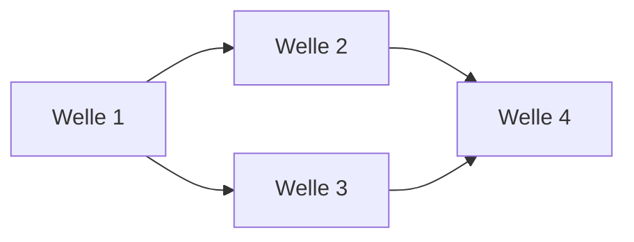

# Roadmap

**Format-Regel:** Die Roadmap ist eine Reihenfolge von **Wellen**,
keine Reihenfolge von Terminen (siehe
Baseline-Regelwerk `modul-06-roadmap.md`).
Termine werden — falls überhaupt — als Konsequenz der Wellen-Schätzung
gezeigt, nicht als Treiber.

---

## Offene Wellen

Arbeit: [slice-kompatibilitaetsserver-an-referenz-angleichen](../done/slice-kompatibilitaetsserver-an-referenz-angleichen.md) und [slice-simulation-mehrere-anweisungen-und-ausgabewert](../in-progress/slice-simulation-mehrere-anweisungen-und-ausgabewert.md) (ohne Welle, Code angleichen, Nutzerentscheidung 2026-11-18); dazu Arbeit: [slice-cancel-antwort-zwei-nachrichten-angleichen](../in-progress/slice-cancel-antwort-zwei-nachrichten-angleichen.md) (ohne Welle, Code angleichen, Nutzerentscheidung 2026-11-18). Zuletzt geschlossen: [slice-fehlertext-unbekannte-tabelle-angleichen](../done/slice-fehlertext-unbekannte-tabelle-angleichen.md) (ohne Welle, [TDS-FA-11](../../../../spec/lastenheft.md#tds-fa-11--mitgeliefertes-simulations-backend), [TDS-FA-06](../../../../spec/lastenheft.md#tds-fa-06--fehler-und-abschlusszustände), [TDS-QA-01](../../../../spec/lastenheft.md#tds-qa-01--kompatibilität), [ADR-0007](../../adr/0007-fehler-und-attention.md), [ADR-0008](../../adr/0008-dotnet-kompatibilitaetstests.md); Text „Invalid object name '<Name>'.“ der unbekannten Tabelle am echten SQL Server 2022 und 2025 gemessen (M-42, Einzelmessung je Instanz) und im Server angeglichen, neues öffentliches Feld `Failure.objectName`, Live-Regel `fehler-vor-zeilen` entfallen; Messprotokoll [referenzabgleich](../../../messungen/referenzabgleich.md); **offen mit Träger Nutzer:** Servername und Zeilennummer im ERROR (Mitschnitt-Regel `fehler-vor-zeilen/01/fehler` bleibt verkleinert), Feld `Failure.objectName` bestätigen und Version `y`, fester Text bei `INSERT BULK`, Probe und Fremdschlüssel-Zieltabelle (Folge-Slice?), Fehler 103 bei Bezeichnern über 128 Zeichen, Setzungen 515 Zeichen und Zeichenmenge; Nachbesserung ohne zweiten Review (`261d9015`, nur Text und KDoc); Verifikation [2026-11-18-slice-fehlertext-unbekannte-tabelle-angleichen-verifikation](../../../reviews/2026-11-18-slice-fehlertext-unbekannte-tabelle-angleichen-verifikation.md)), davor [slice-decimaln-laenge-an-messung-angleichen](../done/slice-decimaln-laenge-an-messung-angleichen.md) (ohne Welle, [TDS-FA-05](../../../../spec/lastenheft.md#tds-fa-05--resultsets-und-datentypen), [TDS-QA-01](../../../../spec/lastenheft.md#tds-qa-01--kompatibilität), [ADR-0008](../../adr/0008-dotnet-kompatibilitaetstests.md); Länge 17 im COLMETADATA von `DECIMALN` und `NUMERICN` am echten SQL Server 2022 und 2025 gemessen (Precisions 1 bis 38, Einzelmessung je Instanz) und im Server angeglichen, A-11 entfallen; Messprotokoll [referenzabgleich](../../../messungen/referenzabgleich.md); **offen mit Träger Nutzer:** W-25 (Länge der Dezimalwerte im ROW: im Slice, Folge-Slice oder Ausnahme), mssql-jdbc gegen Länge 17 ungemessen ([slice-mssql-jdbc-gegen-testserver](../open/slice-mssql-jdbc-gegen-testserver.md)), LOW N-1 und N-2 des Re-Reviews (Text); Verifikation [2026-11-18-slice-decimaln-laenge-an-messung-angleichen-verifikation](../../../reviews/2026-11-18-slice-decimaln-laenge-an-messung-angleichen-verifikation.md)), davor [slice-qa-performance-heap-abschluss](../done/slice-qa-performance-heap-abschluss.md) (`welle-qualitaet-grundlage`, die Welle bleibt offen, [TDS-QA-04](../../../../spec/lastenheft.md#tds-qa-04--performance), [ADR-0006](../../adr/0006-backend-vertrag-und-streaming.md); Heap beim Strom von 10 Mio Zeilen (1, 8, 16 Sitzungen, Aufbau B und C, `-Xmx256m`) und Verzögerung des zurückgehaltenen Abschlusses gemessen, Einzelmessung 2026-11-17, kein Grenzwert; Heap als Stichprobe nach GC, keine Spitze, in 17 von 18 Läufen höchstens 3,5 bis 4,8 MiB; Abschluss im Median D plus 0,4 bis 1,6 ms; Messprotokoll [performance-heap-abschluss-2026-11-17](../../../messungen/performance-heap-abschluss-2026-11-17.md); Werkzeuge `make heap-abschluss` und `make heap-abschluss-tabellen`; **vier Entscheidungen des Nutzers stehen aus** (Zielbild anpassen oder Code angleichen): die Zeilen des letzten Pakets warten mit dem Abschluss, `TCP_NODELAY` am Server, der DoD-Wortlaut „Abstand“ (0 µs), Kosten der `DONE_MORE`-Vorschau nicht von der Pufferung getrennt; offen mit Träger Nutzer: Spitze zwischen Stichproben, Einfluss des Samplers, Streuung (drei Läufe je Zelle, ein Host), Uhrenpräzision, anderer Client, Aufbau C beim Abschluss, echter Treiber, Netz und TLS, Messlauf auf dem End-Stand; Nachbesserung ohne zweiten Review (`d3d55a91`, nur Text); Verifikation [2026-11-17-slice-qa-performance-heap-abschluss-verifikation](../../../reviews/2026-11-17-slice-qa-performance-heap-abschluss-verifikation.md)), davor [slice-mehrfach-rpc-messluecken](../done/slice-mehrfach-rpc-messluecken.md) (ohne Welle, [TDS-FA-04](../../../../spec/lastenheft.md#tds-fa-04--parametrisierte-abfragen-über-rpc), [TDS-QA-01](../../../../spec/lastenheft.md#tds-qa-01--kompatibilität), [ADR-0051](../../adr/0051-mehrere-rpcs-in-einer-nachricht-werden-beantwortet.md); Messlücken am echten SQL Server 2022 und 2025 gemessen, Messprotokoll [referenzabgleich](../../../messungen/referenzabgleich.md#messlücken-zu-mehreren-rpcs-in-einer-nachricht-messungen-vom-2026-11-17) W-14 bis W-22, Einzelmessungen; kein `src/` und kein `testserver/` geändert; **drei Entscheidungen des Nutzers stehen aus** (Zielbild anpassen oder Code angleichen): `sp_prepexec` und `sp_execute` in einer Mehrfach-Nachricht ([ADR-0051](../../adr/0051-mehrere-rpcs-in-einer-nachricht-werden-beantwortet.md) Entscheidung 7 gegen W-20), die Grenzen 1024 Aufrufe und 4096 Parameter (Entscheidung 5 gegen W-21 und W-22), `ntext` als RPC-Parameter (`SPEC-003`, W-22); offen mit Träger Nutzer: Fehler außerhalb der gemessenen Formen, andere Clients, Grenzen oberhalb 1025 und 4206, Abbruch und Frist am echten Server, Trennbyte `0x80`, Wiederholbarkeit; Nachbesserung ohne zweiten Review (`93cde5fb`, nur Namen, Kommentare, Doku); Verifikation [2026-11-17-93cde5fb-verifikation-slice-mehrfach-rpc-messluecken](../../../reviews/2026-11-17-93cde5fb-verifikation-slice-mehrfach-rpc-messluecken.md)), davor [slice-bulk-fuer-eigene-backends](../done/slice-bulk-fuer-eigene-backends.md) (ohne Welle, [TDS-FA-08](../../../../spec/lastenheft.md#tds-fa-08--backend-anbindung), [TDS-QA-04](../../../../spec/lastenheft.md#tds-qa-04--performance), [ADR-0052](../../adr/0052-oeffentliche-flaeche-fuer-massenladen-eigener-backends.md), Option N1 und „Code angleichen“ vom Nutzer entschieden 2026-11-17; `BulkLoadingBackend` und seine Hilfstypen öffentlich, 10 Typnamen in `SPEC-059`, Einbettungstest und Stufe 8 belegt, Aufbau B misst den Import; Messprotokoll [performance-import-b-2026-11-17](../../../messungen/performance-import-b-2026-11-17.md), Einzelmessung, kein Grenzwert, B bei 16 und 64 Sitzungen von C nicht unterscheidbar; offen mit Träger Nutzer: V-1 (der Schutz in `BulkDispatch` nach der Messung geändert, sein Anteil nicht gemessen), anderer Client (d-migrate, mssql-jdbc: [slice-mssql-jdbc-gegen-testserver](../open/slice-mssql-jdbc-gegen-testserver.md) nur für den Testserver), TLS und TDS 8.0, `punkt-import` in B, Namen der Fehler als Strings, neue `y`-Version nur Folgerung; Nachbesserung ohne zweiten Review (`eb5e3d9e` bis `d9c6353d`, nur KDoc, Tags, Protokoll); Verifikation [2026-11-17-slice-bulk-fuer-eigene-backends-verifikation](../../../reviews/2026-11-17-slice-bulk-fuer-eigene-backends-verifikation.md)), davor [slice-qa-performance-rueckstau](../done/slice-qa-performance-rueckstau.md) (`welle-qualitaet-grundlage`, die Welle bleibt offen, [TDS-QA-04](../../../../spec/lastenheft.md#tds-qa-04--performance), [ADR-0006](../../adr/0006-backend-vertrag-und-streaming.md), [ADR-0022](../../adr/0022-e2e-laeufe-nicht-in-den-gates.md); Rückstau am Socket bis 256 Verbindungen, bei blockierendem Backend und beim Simulations-Backend, Einzelmessung 2026-11-17 unter Fremdlast, nur Größenordnung, kein Grenzwert; Messprotokoll [performance-rueckstau-2026-11-17](../../../messungen/performance-rueckstau-2026-11-17.md); Werkzeuge `make rueckstau` und `make rueckstau-tabellen`; offen mit Träger Nutzer: Nachbar-Latenz beim Abbruch nicht aufgeteilt, Ursache der Streuung des Vorlaufs, CPU des Clients, andere Netze, Treiber und TLS, Mutationen über die Prozessgrenze, Einzelmessung ohne Wiederholung; Nachbesserung ohne zweiten Review (`adcfa665`, nur Kommentare); Verifikation [2026-11-17-slice-qa-performance-rueckstau-verifikation](../../../reviews/2026-11-17-slice-qa-performance-rueckstau-verifikation.md)), davor [slice-qa-performance-durchsatz-sitzungen](../done/slice-qa-performance-durchsatz-sitzungen.md) (`welle-qualitaet-grundlage`, die Welle bleibt offen, [TDS-QA-04](../../../../spec/lastenheft.md#tds-qa-04--performance), [ADR-0022](../../adr/0022-e2e-laeufe-nicht-in-den-gates.md); Staffel 1, 8, 16, 64 Sitzungen mit Durchsatz und Punktabfrage, Einzelmessung 2026-11-17 unter Fremdlast, nur Größenordnung, kein Grenzwert; Messprotokoll [performance-durchsatz-2026-11-17](../../../messungen/performance-durchsatz-2026-11-17.md); Werkzeug `make lasttest-tabellen`; offen mit Träger Nutzer: Import in Aufbau B, Träger der Fläche nach [ADR-0052](../../adr/0052-oeffentliche-flaeche-fuer-massenladen-eigener-backends.md) (Option N1, `Accepted`) und des Imports in B: [slice-bulk-fuer-eigene-backends](../done/slice-bulk-fuer-eigene-backends.md), geschlossen; ungemessen: CPU von Client und Server, Einfluss der Senke, ruhiger Host; Verifikation [2026-11-17-slice-qa-performance-durchsatz-sitzungen-verifikation](../../../reviews/2026-11-17-slice-qa-performance-durchsatz-sitzungen-verifikation.md)), davor [slice-mehrfach-rpc-unterstuetzen](../done/slice-mehrfach-rpc-unterstuetzen.md) (ohne Welle, [TDS-FA-04](../../../../spec/lastenheft.md#tds-fa-04--parametrisierte-abfragen-über-rpc), [TDS-QA-01](../../../../spec/lastenheft.md#tds-qa-01--kompatibilität), [ADR-0051](../../adr/0051-mehrere-rpcs-in-einer-nachricht-werden-beantwortet.md); der Server nimmt mehrere RPCs in einer Nachricht an und beantwortet sie nach der am echten Server gemessenen Form (Trennbyte `0xFF`, DONEPROC `MORE|0x80` außer am letzten); `UpdateBatchSize` 2 gelingt am Serverprozess (Stufe 6); Messprotokoll [Mehrere RPCs in einer Nachricht](../../../messungen/referenzabgleich.md#mehrere-rpcs-in-einer-nachricht-messungen-vom-2026-11-17); offen: Fälle ohne Messung (Ergebnismengen, Fehler im ersten oder letzten Aufruf, `0x80`, anderer Client) und die Entwurfssätze in [ADR-0051](../../adr/0051-mehrere-rpcs-in-einer-nachricht-werden-beantwortet.md) mit Träger Nutzer; Verifikation [2026-11-17-4c7b069b](../../../reviews/2026-11-17-4c7b069b-verifikation-slice-mehrfach-rpc-unterstuetzen.md)), davor [slice-antwortform-nbcrow](../done/slice-antwortform-nbcrow.md) (ohne Welle, [TDS-FA-05](../../../../spec/lastenheft.md#tds-fa-05--resultsets-und-datentypen), [ADR-0006](../../adr/0006-backend-vertrag-und-streaming.md); der Sequenzierer wählt je Zeile ROW oder NBCROW nach der am echten Server gemessenen Regel, A-12 entfallen; Messprotokoll [zeilenform-nbcrow-2026-11-17](../../../messungen/zeilenform-nbcrow-2026-11-17.md); offen mit Träger Nutzer: Client mssql-jdbc gegen NBCROW dieses Servers ungemessen, A-11; Verifikation [2026-11-17-853239d5](../../../reviews/2026-11-17-853239d5-verifikation-slice-antwortform-nbcrow.md)), davor [slice-release-job-im-workflow-bauen](../done/slice-release-job-im-workflow-bauen.md) (ohne Welle, [ADR-0050](../../adr/0050-github-release-im-tag-lauf.md), [TDS-RB-05](../../../../spec/lastenheft.md#tds-rb-05--lizenz); Job `release`, Eingangsskript `tools/release-anlegen.sh` und Notiz-Vorlage im Zustand „gebaut, nicht gelaufen“, am Stub und am Linter belegt, nie gegen GitHub; offen mit Träger Nutzer: Hostausführung gegen `AGENTS.md` §3.1, `--ohne-dateien` nur `v0.1.0` und `v0.1.1`, `--limit 1000`; offene LOW: V-1, V-2; ungemessen mit Träger [slice-release-im-tag-lauf-messen](../open/slice-release-im-tag-lauf-messen.md); Verifikation [2026-11-16-925487ed](../../../reviews/2026-11-16-925487ed-slice-release-job-im-workflow-bauen-verifikation.md)), davor [slice-codec-datentypen-erweiterung](../done/slice-codec-datentypen-erweiterung.md) (ohne Welle; [TDS-FA-05](../../../../spec/lastenheft.md#tds-fa-05--resultsets-und-datentypen), [ADR-0006](../../adr/0006-backend-vertrag-und-streaming.md); PLP, NBCROW im Encoder und `sql_variant` mit Basistyp `int` im Codec, `nvarchar(max)` als Wertparameter; offen mit Träger Nutzer: A-11, Obergrenze, weitere Basistypen, Typkatalog; Verifikation [2026-11-16-5ef12076](../../../reviews/2026-11-16-5ef12076-slice-codec-datentypen-erweiterung-verifikation.md)), davor [slice-release-dateien-bauen](../done/slice-release-dateien-bauen.md) (ohne Welle, [ADR-0050](../../adr/0050-github-release-im-tag-lauf.md), [TDS-RB-05](../../../../spec/lastenheft.md#tds-rb-05--lizenz), [TDS-QA-06](../../../../spec/lastenheft.md#tds-qa-06--reproduzierbarkeit); `make release-dateien` lokal gelaufen, nicht in der CI gelaufen; offene Fragen an den Nutzer stehen in §7 des Slice; Verifikation [2026-11-16-08fba8d3](../../../reviews/2026-11-16-08fba8d3-slice-release-dateien-bauen-verifikation.md)), davor [slice-release-lizenzen-lib-belegen](../done/slice-release-lizenzen-lib-belegen.md) (ohne Welle, [ADR-0050](../../adr/0050-github-release-im-tag-lauf.md), [TDS-RB-05](../../../../spec/lastenheft.md#tds-rb-05--lizenz); Beleg [lizenzen-lib-2026-11-16](../../../messungen/lizenzen-lib-2026-11-16.md), Lizenzdateien unter `lizenzen/lib/`; offene Fragen an den Nutzer stehen im Beleg, Eingang für [slice-release-im-tag-lauf-messen](../open/slice-release-im-tag-lauf-messen.md); Verifikation [2026-11-16-456df041](../../../reviews/2026-11-16-456df041-slice-release-lizenzen-lib-belegen-verifikation.md)), davor [slice-qa-performance](../done/slice-qa-performance.md) (`welle-qualitaet-grundlage`, die Welle bleibt offen; Workload freigegeben am 2026-11-16, Werkzeug `make lasttest`, E2E-Stufe 9; Probe-Messzeilen sind Einzelmessungen, kein Grenzwert; Verifikation [2026-11-16-195d1cca](../../../reviews/2026-11-16-195d1cca-slice-qa-performance-verifikation.md)), davor [slice-cloudsmith-veroeffentlichung-0-1-1](../done/slice-cloudsmith-veroeffentlichung-0-1-1.md). Noch nicht startbar: [slice-qa-performance-grenzwerte](../open/slice-qa-performance-grenzwerte.md) (die drei Messungen liegen in `done/` ([slice-qa-performance-durchsatz-sitzungen](../done/slice-qa-performance-durchsatz-sitzungen.md), [slice-qa-performance-rueckstau](../done/slice-qa-performance-rueckstau.md), [slice-qa-performance-heap-abschluss](../done/slice-qa-performance-heap-abschluss.md)); Start erst nach der Bestätigung der abgeleiteten Zahlen durch den Nutzer). Nicht ohne den Nutzer startbar: [slice-release-im-tag-lauf-messen](../open/slice-release-im-tag-lauf-messen.md) (Start-Bedingung 1 erfüllt; 3 bis 6 beim Nutzer: Version, Push und Tag-Schutz, Lizenzbeleg gelesen, Verantwortlicher), danach [slice-release-nachtraeglich-bestandstags](../open/slice-release-nachtraeglich-bestandstags.md). Ohne Welle, nicht ohne den Nutzer startbar (je Slice die Entscheidung „Code angleichen / Zielbild anpassen“, `Verantwortlich: —`; Träger der Lücken der Ausnahmeliste des Referenzabgleichs, die Reihenfolge `decimaln-laenge-an-messung-angleichen` vor `simulation-schemaonly-keyinfo` ist eine Empfehlung): [slice-simulation-mehrere-anweisungen-und-ausgabewert](../in-progress/slice-simulation-mehrere-anweisungen-und-ausgabewert.md), [slice-simulation-anweisungsformen-erweitern](../open/slice-simulation-anweisungsformen-erweitern.md), [slice-cancel-antwort-zwei-nachrichten-angleichen](../in-progress/slice-cancel-antwort-zwei-nachrichten-angleichen.md), [slice-simulation-schemaonly-keyinfo](../open/slice-simulation-schemaonly-keyinfo.md), [slice-kompatibilitaetsserver-an-referenz-angleichen](../done/slice-kompatibilitaetsserver-an-referenz-angleichen.md), [slice-fehlertext-unbekannte-tabelle-angleichen](../done/slice-fehlertext-unbekannte-tabelle-angleichen.md). Ohne Welle, nicht ohne den Nutzer startbar (Nutzerzeichen und Verantwortlicher; `Verantwortlich: —`): [slice-mehrfach-rpc-messluecken](../done/slice-mehrfach-rpc-messluecken.md) (Messung am echten SQL Server zu [ADR-0051](../../adr/0051-mehrere-rpcs-in-einer-nachricht-werden-beantwortet.md), nicht parallel zu `make lasttest` und den Messslices der Welle `welle-qualitaet-grundlage`) und [slice-mssql-jdbc-gegen-testserver](../open/slice-mssql-jdbc-gegen-testserver.md) (mssql-jdbc gegen NBCROW und Mehrfach-RPC am Testserver und an den gepinnten Instanzen 2022 und 2025; eigenes Nicht-Gate-Target neben `make e2e`, Entscheidung des Nutzers 2026-11-17).

Regeln dieser Sektion: Baseline-Regelwerk `modul-06-roadmap.md`
§Roadmap-Struktur: fünf Abschnitte — *Offene Wellen* ist **derivativ**: Der
Zustand sind die flachen Welle-Dateien; woran gearbeitet wird, sagt das
`Welle:`-Feld der Slices in `in-progress/`. Ziel, Trigger und
Closure-Kriterien stehen in der Welle-Datei, nicht hier.

- [welle-qualitaet-grundlage](../welle-qualitaet-grundlage.md)

In Arbeit (Welle welle-qualitaet-grundlage):

- in `in-progress/`: keiner; zuletzt geschlossen: [slice-qa-performance-heap-abschluss](../done/slice-qa-performance-heap-abschluss.md) (Closure-Notiz in §7 des Slice; Heap und Abschluss gemessen, siehe „Offene Wellen“; vier Entscheidungen des Nutzers offen; Register `BEO-TDS/rueckstau-im-produktivbetrieb-nicht-gemessen` Teil gemessen, `BEO-TDS/skript-pruefung-ohne-rot-gegenprobe` 4×), davor [slice-qa-performance-rueckstau](../done/slice-qa-performance-rueckstau.md) (Closure-Notiz in §7 des Slice; Rückstau gemessen, siehe „Offene Wellen“; Register `BEO-TDS/rueckstau-zusage-nur-test-backend-traeger-unvollstaendig` gelöst, `BEO-TDS/skript-pruefung-ohne-rot-gegenprobe` 3×), davor [slice-listener-abort-test-ordnungswette](../done/slice-listener-abort-test-ordnungswette.md) (Closure-Notiz in §7 des Slice; `ListenerAbortTest` wartet am Ereignis des Handlers auf den Abbruch; Verifikation statt Review, Entscheid des Orchestrators; offen: Lauf unter natürlicher Last nach dem Umbau, `BEO-TDS/wanduhr-tests-flackern-unter-last`), davor [slice-qa-test-stage-run-kopplung](../done/slice-qa-test-stage-run-kopplung.md) (Closure-Notiz in §7 des Slice; `dotnet test` der Stages `test` und `test-bericht` läuft über `test-lauf.sh`, ein Flag am Skriptaufruf wird abgewiesen; Selbsttest mit 9 Mutationen und Exit 3 ohne ausgeführten Test bei fester Locale; eine RUN-Zeile ohne `test-lauf.sh` bleibt ungekoppelt, Grenze entschieden in `BEO-TDS/schwesterstage-ohne-gleichlauf-sensor`; Nachbesserung ohne zweiten Review; offen: Wortlaut des echten `dotnet` nur durch Handmessung belegt, `BEO-TDS/gate-liest-wortlaut-einer-werkzeugmeldung-ohne-locale`), davor [slice-spec-abdeckung-liest-csharp](../done/slice-spec-abdeckung-liest-csharp.md) (Closure-Notiz in §7 des Slice; `make spec-abdeckung` liest C#-Tests, [SPEC-045](../../../../spec/spezifikation.md#spec-045--referenzabgleich-ablauf-und-ausnahmeliste-vorläufig) mit 20 Nachweisen; Kopplung der `RUN`-Zeile der Stage `test` geliefert in [slice-qa-test-stage-run-kopplung](../done/slice-qa-test-stage-run-kopplung.md); offen: Gradle-Teil am Layer-Cache, `BEO-TDS/abdeckungsmatrix-veraltet-ohne-sensor`), davor [slice-e2e-backend-ausserhalb-modul](../done/slice-e2e-backend-ausserhalb-modul.md) (Closure-Notiz in §7 des Slice; Stufe 8 von `make e2e` belegt [TDS-FA-08](../../../../spec/lastenheft.md#tds-fa-08--backend-anbindung) und [TDS-RB-04](../../../../spec/lastenheft.md#tds-rb-04--externes-backend); offen: Nachbesserung ohne zweiten Review, Schwellen-Vorschläge `BEO-TDS/aussage-ueber-schichtgrenze-ohne-test` und `BEO-TDS/plan-tabelle-nennt-neue-datei-nicht`), davor [slice-qa-dotnet-lieferkette-haerten](../done/slice-qa-dotnet-lieferkette-haerten.md) (Closure-Notiz in §7 des Slice; [CO-001](../../carveouts/done/CO-001-nuget-audit-aus.md) und [CO-002](../../carveouts/done/CO-002-nuget-signaturpruefung-fehlt.md) aufgelöst, [ADR-0035](../../adr/0035-dotnet-restore-signaturliste-und-audit-verzicht.md); offen: Selbsttest der Signaturliste, `BEO-TDS/signaturliste-ohne-selbsttest`, Zertifikatsrotation, `BEO-TDS/restore-haengt-am-zertifikatsstand-des-tages`), davor [slice-e2e-geruest](../done/slice-e2e-geruest.md) (Closure-Notiz in §7 des Slice; offen: Warm-/Kaltmessung der sieben Stufen, Register `BEO-TDS/e2e-nachweis-ohne-stufe-oder-messung`)

In Arbeit (ohne Welle):

- in `in-progress/`: keiner; zuletzt geschlossen: [slice-cloudsmith-veroeffentlichung-0-1-1](../done/slice-cloudsmith-veroeffentlichung-0-1-1.md) (Closure-Notiz in §7 des Slice; [TDS-RB-05](../../../../spec/lastenheft.md#tds-rb-05--lizenz), [ADR-0049](../../adr/0049-cloudsmith-als-zweites-veroeffentlichungsziel.md); Tag-Lauf 43734101990), davor [slice-ci-veroeffentlichung-workflow](../done/slice-ci-veroeffentlichung-workflow.md) (Closure-Notiz in §7 des Slice; [TDS-RB-05](../../../../spec/lastenheft.md#tds-rb-05--lizenz), [TDS-QA-06](../../../../spec/lastenheft.md#tds-qa-06--reproduzierbarkeit), [ADR-0048](../../adr/0048-veroeffentlichung-in-der-ci-bei-tag-push.md); Workflow `veroeffentlichung.yml`, Dispatch-Lauf 43619591947 `success` bei `publish` übersprungen, Messprotokoll [veroeffentlichung-dispatch-2026-11-15](../../../messungen/veroeffentlichung-dispatch-2026-11-15.md); Docker-Version des Runners als Anforderung entfallen (Nutzerentscheidung 2026-11-15); offen: Schreibrecht, Zuordnung, Maskierung und Klon eines Tag-Push nur durch die erste Veröffentlichung, Folge: [slice-maven-erste-veroeffentlichung](../done/slice-maven-erste-veroeffentlichung.md); Register `BEO-TDS/wanduhr-tests-flackern-unter-last` um einen Auftritt auf dem Runner ergänzt), davor [slice-maven-veroeffentlichung](../done/slice-maven-veroeffentlichung.md) (Closure-Notiz in §7 des Slice; [TDS-RB-05](../../../../spec/lastenheft.md#tds-rb-05--lizenz), [ADR-0047](../../adr/0047-veroeffentlichung-ueber-github-packages.md); POM, Prüfung im Bau, `make publish-vorschau` und `make publish`, nichts nach GitHub geschrieben; zweiter Review nur auf `7b0add15`/`20078de0`, `fbce5d7d` ohne dritten Review; Nutzerpunkte entschieden 2026-11-14: `read:packages`-Anleitung im Folge-Slice, `tools/publish-probe.sh` bleibt bis zu dessen Closure; Folge: [slice-ci-veroeffentlichung-workflow](../done/slice-ci-veroeffentlichung-workflow.md), danach [slice-maven-erste-veroeffentlichung](../done/slice-maven-erste-veroeffentlichung.md)), davor [slice-inspektionstest-puffer-unabhaengig](../done/slice-inspektionstest-puffer-unabhaengig.md) (Closure-Notiz in §7 des Slice; `TestserverLaufInspektionTest` mit fester Menge ohne Host-Wert, `gates` auf `main` `success` (Lauf 43590894587); Nachbesserung ohne zweiten Review; offen: Host mit Obergrenzen-Summe über 40 MiB, `BEO-TDS/annahme-ueber-puffer-der-umgebung`), davor [slice-stempel-migration](../done/slice-stempel-migration.md) (Closure-Notiz in §7 des Slice; offene Nutzerpunkte: Pflichtmenge der Klasse `immer` ([ADR-0031](../../adr/0031-gates-ohne-stempel-klasse-immer.md) Frage (b)), Grenze `assume-unchanged`, Host-Gates ohne Stage-Paar, CI-Seite)

## Nächste Wellen

Regeln dieser Sektion: Baseline-Regelwerk `modul-06-roadmap.md`
§Roadmap-Struktur: fünf Abschnitte, Bullet *Nächste Wellen* — die geordnete
Vorschau: je Zeile Welle, Trigger als beobachtbare Bedingung, wichtigste Slices
und geschätzter Aufwand (S/M/L, kein Termin).

| Welle | Trigger | Wichtigste Slices | Geschätzter Aufwand |
|---|---|---|---|
| <welle-id-a> | <Vorgänger-Welle> done | <…> | S/M/L |
| <welle-id-b> | <welle-id-a> done + ADR-<NNNN> accepted | <…> | S/M/L |

## Meilensteine

Regeln dieser Sektion: Baseline-Regelwerk `modul-06-roadmap.md`
§Welle ≠ Meilenstein ≠ Release.

| Meilenstein | Welle(n) | Trigger | Status |
|---|---|---|---|
| M1 | <welle-id> | <…> | erreicht / offen |

## Abhängigkeitsgraph

Regeln dieser Sektion: Baseline-Regelwerk `modul-06-roadmap.md`
§Roadmap-Struktur: fünf Abschnitte, Bullet *Nächste Wellen* — die Abhängigkeit
steht als beobachtbare Bedingung in der `Trigger`-Spalte **und** als gerichtete
Kante hier; eine Welle, die ohne fertige Vorgängerin nicht starten kann, ist
eine Phantom-Welle.

## Abgeschlossene Wellen

Regeln dieser Sektion: Baseline-Regelwerk `modul-06-roadmap.md`
§Roadmap-Struktur: fünf Abschnitte.

| Welle | Abschluss | Closure-Notiz |
|---|---|---|
| welle-protokollcodec | 2026-10-30 | [welle-protokollcodec-results](../done/welle-protokollcodec-results.md) |
| welle-entscheidungen-grundlage | 2026-10-30 | [welle-entscheidungen-grundlage-results](../done/welle-entscheidungen-grundlage-results.md) |
| welle-transport-tls | 2026-10-31 | [welle-transport-tls-results](../done/welle-transport-tls-results.md) |
| welle-handshake-login | 2026-10-31 | [welle-handshake-login-results](../done/welle-handshake-login-results.md) |
| welle-backend-streaming | 2026-10-31 | [welle-backend-streaming-results](../done/welle-backend-streaming-results.md) |
| welle-simulations-backend | 2026-10-31 | [welle-simulations-backend-results](../done/welle-simulations-backend-results.md) |
| welle-fehler-abbruch | 2026-11-06 | [welle-fehler-abbruch-results](../done/welle-fehler-abbruch-results.md) |
| welle-anfrageverarbeitung | 2026-11-07 | [welle-anfrageverarbeitung-results](../done/welle-anfrageverarbeitung-results.md) |
| welle-produktschnitt | 2026-11-07 | [welle-produktschnitt-results](../done/welle-produktschnitt-results.md) |
| welle-testserver-manuell | 2026-11-13 | [welle-testserver-manuell-results](../done/welle-testserver-manuell-results.md) |
| welle-betrieb-diagnose | 2026-11-13 | [welle-betrieb-diagnose-results](../done/welle-betrieb-diagnose-results.md) |
| welle-referenzabgleich-release | 2026-11-17 | [welle-referenzabgleich-release-results](../done/welle-referenzabgleich-release-results.md) |

## Historische Trigger-Verschiebungen

Regeln dieser Sektion: Baseline-Regelwerk `modul-06-roadmap.md`
§Roadmap-Struktur: fünf Abschnitte, Bullet *Historische Trigger-Verschiebungen*
— das Drift-Log: jede Umplanung mit Datum, Änderung, Grund. Leer heißt starre
Roadmap, jede Zeile voll heißt treibende.

| Datum | Was wurde geändert? | Warum? |
|---|---|---|
| 2026-10-30 | Start-Trigger von slice-adr-simulation-formen: statt „Start-Trigger der Welle welle-simulations-backend eingetreten“ gilt „slice-backend-port-vertrag in done/ und Start der Welle vom Nutzer verlangt“; Wellen-Trigger für die Code-Slices unverändert | Der Entscheidungs-Slice braucht keinen Code aus welle-backend-streaming (nur den Port); der Nutzer hat den Start verlangt |
| 2026-10-31 | slice-codec-datentypen-erweiterung (`open/`) von „ohne Welle“ in welle-anfrageverarbeitung aufgenommen | Entscheidung des Nutzers; Start-Trigger des Slice unverändert (Beleg, dass der Referenzclient die Formen sendet) |
| 2026-11-01 | slice-attention-cancel-timeout (welle-fehler-abbruch) zerlegt: Der Abbruchpfad mit Fristen bleibt unter diesem Namen, das Cancel-Szenario von SPEC-040 und der Cancel-Teil von [TDS-QA-07](../../../../spec/lastenheft.md#tds-qa-07--protokoll-synchronität) am Referenzclient gehen in slice-cancel-referenzclient-szenario; neu in derselben Welle: slice-resetconnection-zuruecksetzen. Start-Trigger statt der drei Nutzerentscheidungen: [ADR-0027](../../adr/0027-abbruch-und-zuruecksetzen.md) Accepted | Fünf Liefer-Punkte lagen über der Grenze von drei; die Nutzerentscheidungen liegen mit [ADR-0027](../../adr/0027-abbruch-und-zuruecksetzen.md) vor |
| 2026-11-01 | Start-Trigger von [welle-produktschnitt](../done/welle-produktschnitt.md) gelockert: statt „[ADR-0025](../../adr/0025-produktschnitt-bibliothek-und-testserver.md) `Accepted` und [welle-anfrageverarbeitung](../done/welle-anfrageverarbeitung.md), [welle-fehler-abbruch](../done/welle-fehler-abbruch.md), [welle-betrieb-diagnose](../done/welle-betrieb-diagnose.md) in `done/`“ gilt „[ADR-0025](../../adr/0025-produktschnitt-bibliothek-und-testserver.md) `Accepted` und der Nutzer verlangt den Start“; der Slice [slice-explicit-api-umbau](../done/slice-explicit-api-umbau.md) (`open/`) von „ohne Welle“ in diese Welle aufgenommen, Start-Trigger des Slice: `slice-testserver-herausloesen` in `done/` | Nutzerentscheidung 2026-11-01: Die Auswahl der drei Wellen war eine Lesart des Planners und ist hinfällig; der Umbau soll nicht auf Betrieb und Abbruch warten, und `explicitApi` soll erst nach dem Testserver-Umbau schließen, damit nicht zweimal umgebaut wird |
| 2026-11-01 | [welle-betrieb-diagnose](../done/welle-betrieb-diagnose.md) nach Annahme von [ADR-0020](../../adr/0020-logformat-und-observability-schnittstelle.md) neu zugeschnitten: Slices [slice-spec-nachzug-telemetrie](../done/slice-spec-nachzug-telemetrie.md) und [slice-betrieb-log-adapter-testserver](../done/slice-betrieb-log-adapter-testserver.md) neu; Start-Trigger von `slice-betrieb-log-schnittstelle` und des Adapter-Slice an `slice-testserver-herausloesen` aus [welle-produktschnitt](../done/welle-produktschnitt.md) gebunden, die der Zustands- und Metriken-Slice an den Adapter-Slice | [ADR-0020](../../adr/0020-logformat-und-observability-schnittstelle.md) legt Modell und Senke in die Bibliothek und das Format als Adapter in den Testserver; der frühere Punkt „Adapter und Konfiguration“ hätte den Slice auf sechs Liefer-Punkte gebracht |
| 2026-11-01 | [welle-referenzabgleich-release](../done/welle-referenzabgleich-release.md): Vermerk „berührt durch [ADR-0025](../../adr/0025-produktschnitt-bibliothek-und-testserver.md)“ am Closure-Kriterium „Läufe gegen das Laufzeit-Image“ und an der Nutzer-Doku zum Start im Container; Wortlaut nicht umgeschrieben, das Umschreiben ist Teil von `slice-jar-ohne-main-und-image` | Nutzerentscheidung 2026-11-01: [ADR-0025](../../adr/0025-produktschnitt-bibliothek-und-testserver.md) entfernt das Produkt-Image, umgeschrieben wird erst im Zug des Bau-Slice |
| 2026-11-01 | Spec-Nachzug zu Abschnitt 4 und 5 aus dem Liefer-Punkt 3 von slice-adr-observability gelöst und bei [slice-spec-nachzug-telemetrie](../done/slice-spec-nachzug-telemetrie.md) geführt; [welle-betrieb-diagnose](../done/welle-betrieb-diagnose.md) §4 nennt den Slice ohne Spec-Arbeit | Review M-4 von slice-adr-observability: zwei Träger für dieselbe Spec-Arbeit; Bestätigung durch den Nutzer steht aus |
| 2026-11-01 | [slice-betrieb-telemetrie-verdrahtung-belegen](../done/slice-betrieb-telemetrie-verdrahtung-belegen.md) in [welle-betrieb-diagnose](../done/welle-betrieb-diagnose.md) aufgenommen | Verifikation von [slice-betrieb-log-schnittstelle](../done/slice-betrieb-log-schnittstelle.md): `AcceptFailed` und `ConnectionFailed` ohne Test über den Server, Ausgabe-Sperre ohne Rot-Fall je Package |
| 2026-11-06 | Start-Trigger von [slice-katalog-und-ddl-zustand](../done/slice-katalog-und-ddl-zustand.md), [slice-schreibpfad-bulk-load](../done/slice-schreibpfad-bulk-load.md), [slice-schreibpfad-merge-output](../done/slice-schreibpfad-merge-output.md) und [slice-oeffentliche-flaeche-verkleinern-und-belegen](../done/slice-oeffentliche-flaeche-verkleinern-und-belegen.md) um die Kette Modul-Umbau, Schnitt der Fläche, Katalog ergänzt; [slice-adr-handle-grenze-ersatz](../done/slice-adr-handle-grenze-ersatz.md) neu in [welle-testserver-manuell](../done/welle-testserver-manuell.md), vor dem MERGE-Slice | Nutzerentscheidung 2026-11-06 ([ADR-0033](../../adr/0033-callback-loesung-fuer-schreiben-struktur-und-massenladen.md), [ADR-0034](../../adr/0034-testserver-als-gradle-modul.md)): Reihenfolge der Folge-Slices abweichend vom Entwurf; die Handle-Grenze von [ADR-0017](../../adr/0017-prepared-handles-grenzwert.md) bricht den MERGE-Import |
| 2026-11-06 | [slice-handle-freigabe-und-grenze-bauen](../done/slice-handle-freigabe-und-grenze-bauen.md) neu in [welle-testserver-manuell](../done/welle-testserver-manuell.md), nach Modul-Umbau und Schnitt der Fläche, vor [slice-schreibpfad-merge-output](../done/slice-schreibpfad-merge-output.md) (dessen Start-Trigger um ihn ergänzt) | Folgepflicht 2 von [ADR-0036](../../adr/0036-handle-freigabe-und-grenze-je-sitzung.md) (`Accepted`, Option D mit B): Bau getrennt von der Entscheidung |
| 2026-11-06 | [slice-qa-passwortvergleich-gemischte-liste](../open/slice-qa-passwortvergleich-gemischte-liste.md) neu in [welle-qualitaet-grundlage](../welle-qualitaet-grundlage.md) | Nutzerentscheid 2026-11-06: Träger der Beobachtung `BEO-TDS/passwortvergleich-gemischte-liste-ohne-traeger` (Review F-4); Passung: Bezug [TDS-QA-03](../../../../spec/lastenheft.md#tds-qa-03--sicherheit), die Welle belegt die Qualitätsseite |
| 2026-11-06 | [slice-adr-sp-execute-unbekanntes-handle](../done/slice-adr-sp-execute-unbekanntes-handle.md) und [slice-qa-vergleichslauf-d-messungen-bulk-merge](../done/slice-qa-vergleichslauf-d-messungen-bulk-merge.md) neu in [welle-testserver-manuell](../done/welle-testserver-manuell.md) | Nutzerentscheid 2026-11-06 („deine Empfehlungen“): Zielbild-Konflikt zu `sp_execute` mit unbekanntem Handle (ADR-Entwurf) und Messungen am echten Server zu Massenladen und MERGE; Passung: Handle-Fehler und Schreibpfad liegen in der Welle, beide Slices schließen sie mit (kein Soll der Abnahme) |
| 2026-11-06 | [slice-qa-test-stage-run-kopplung](../done/slice-qa-test-stage-run-kopplung.md) neu in [welle-qualitaet-grundlage](../welle-qualitaet-grundlage.md) | Nutzerentscheid 2026-11-06: Träger der Beobachtung `BEO-TDS/schwesterstage-ohne-gleichlauf-sensor`; Passung: Bezug [TDS-QA-05](../../../../spec/lastenheft.md#tds-qa-05--wartbarkeit), die Welle belegt die Qualitätsseite |
| 2026-11-06 | [slice-antwort-tokens-an-messung-angleichen](../done/slice-antwort-tokens-an-messung-angleichen.md): Nr 8 (SESSIONSTATE) von Bau auf „kein Bau, dokumentierte Lücke“ umgestellt | Nutzerentscheid 2026-11-06: vorerst nicht senden; Re-Evaluierungs-Trigger „Treiber oder Pool zeigt Bedarf"
| 2026-11-06 | [slice-katalog-indizes-defaults-fremdschluessel](../done/slice-katalog-indizes-defaults-fremdschluessel.md) neu in [welle-testserver-manuell](../done/welle-testserver-manuell.md); [slice-qa-vergleichslauf-d-messungen-bulk-merge](../done/slice-qa-vergleichslauf-d-messungen-bulk-merge.md) trägt zusätzlich die Katalogmessung (Liefer-Punkt 2, die Liefer-Punkte neu geschnitten) | Nutzerentscheid 2026-11-06 („deine Empfehlungen“) zu den Verifikationsbefunden V-1 und V-3 von [slice-katalog-und-ddl-zustand](../done/slice-katalog-und-ddl-zustand.md): Träger der Gegenmessung und der leeren Sichten; Passung: Bezug [TDS-FA-11](../../../../spec/lastenheft.md#tds-fa-11--mitgeliefertes-simulations-backend), die Welle trägt den Katalog |
| 2026-11-06 | [slice-listener-annahmeschleife-bei-erschoepften-dateien](../done/slice-listener-annahmeschleife-bei-erschoepften-dateien.md) neu in [welle-betrieb-diagnose](../done/welle-betrieb-diagnose.md), Start-Trigger: [slice-betrieb-telemetrie-verdrahtung-belegen](../done/slice-betrieb-telemetrie-verdrahtung-belegen.md) in `done/` | Review F-2 von slice-betrieb-telemetrie-verdrahtung-belegen: bei erschöpftem Limit offener Dateien steht die Annahmeschleife still und ohne Meldung; Auftrag des Nutzers 2026-11-06 |
| 2026-11-07 | [slice-mehrfach-rpc-unterstuetzen](../done/slice-mehrfach-rpc-unterstuetzen.md) neu in [welle-anfrageverarbeitung](../done/welle-anfrageverarbeitung.md) als Vorrat (kein Closure-Kriterium) | Nutzerentscheid 2026-11-07 zu [ADR-0039](../../adr/0039-abschluss-der-antwort-auf-eine-rpc-nachricht-die-der-parser-abweist.md) (`Accepted`, Option B): Mehrfach-RPC unterstützen ist ein eigenes Planungsthema; Passung: Bezug [TDS-FA-04](../../../../spec/lastenheft.md#tds-fa-04--parametrisierte-abfragen-über-rpc), die Welle trägt die Anfrageverarbeitung |
| 2026-11-07 | Vier Slices neu in [welle-testserver-manuell](../done/welle-testserver-manuell.md): [slice-katalog-und-struktur-an-messung-angleichen](../done/slice-katalog-und-struktur-an-messung-angleichen.md), [slice-sp-unprepare-ohne-obergrenze](../done/slice-sp-unprepare-ohne-obergrenze.md), [slice-adr-massenladen-atomar-an-messung](../done/slice-adr-massenladen-atomar-an-messung.md), [slice-antwort-tokens-zielbild-luecken-bauen](../done/slice-antwort-tokens-zielbild-luecken-bauen.md); der letzte löst den Trigger „nach der A-20-Messung wird der Bau-Slice angelegt“ aus [slice-antwort-tokens-an-messung-angleichen](../done/slice-antwort-tokens-an-messung-angleichen.md) und [slice-qa-vergleichslauf-d-messungen-bulk-merge](../done/slice-qa-vergleichslauf-d-messungen-bulk-merge.md) ein (statt Lücken ohne Bau in Register-Einträgen); [slice-schreibpfad-merge-output](../done/slice-schreibpfad-merge-output.md) trägt zusätzlich den Messauftrag mit dem JDBC-Client | Nutzerentscheide 2026-11-07 zu den Konflikten der Messreihe M-8 bis M-24 mit dem Zielbild (Spezifikation ist Zielbild, der echte SQL Server die Referenz): Bau statt Register-Eintrag allein; Passung: Bezug [TDS-QA-01](../../../../spec/lastenheft.md#tds-qa-01--kompatibilität), die Welle trägt Katalog, Schreibpfad und Antworten; die Slices sind Bedingung des Closure-Triggers der Welle, für die Abnahme drei Grenze und einer Eingang |
| 2026-11-07 | [slice-bulk-load-feste-typen-und-referenzclient](../done/slice-bulk-load-feste-typen-und-referenzclient.md) neu in [welle-testserver-manuell](../done/welle-testserver-manuell.md) | Verifikation V-1 von [slice-schreibpfad-bulk-load](../done/slice-schreibpfad-bulk-load.md): der Referenzclient erreicht das Massenladen am Testserver nicht; Nutzerentscheid 2026-11-07 („deine Empfehlungen Regelwerk konform“, Zielbild: der echte Server nimmt `SqlBulkCopy` an); Start-Trigger: [slice-schreibpfad-bulk-load](../done/slice-schreibpfad-bulk-load.md) in `done/` |
| 2026-11-07 | [slice-einstellungen-in-typen-buendeln](../done/slice-einstellungen-in-typen-buendeln.md) und [slice-request-failed-mit-request-id](../done/slice-request-failed-mit-request-id.md) neu in [welle-betrieb-diagnose](../done/welle-betrieb-diagnose.md), Start-Trigger: [slice-betrieb-metriken-tracing](../done/slice-betrieb-metriken-tracing.md) in `done/` | Nutzerentscheide 2026-11-07 zu Verifikation V-5 von slice-betrieb-metriken-tracing: Einstellungen von `ServerConfig` in benannten Typen bündeln (statt sechstem Parameter von `RequestSettings`), `requestId` in `REQUEST_FAILED`; Passung: Bezug [TDS-FA-09](../../../../spec/lastenheft.md#tds-fa-09--konfiguration-und-diagnose), die Welle trägt die Diagnose |
| 2026-11-08 | [slice-katalog-und-struktur-an-messung-angleichen](../done/slice-katalog-und-struktur-an-messung-angleichen.md) auf die Strukturabweisung und `CREATE TABLE` ohne Schlüssel verkleinert; neu in [welle-testserver-manuell](../done/welle-testserver-manuell.md): [slice-katalogspalten-smallint-tinyint-angleichen](../done/slice-katalogspalten-smallint-tinyint-angleichen.md) (Katalogspalten, `SqlType.Int16` und `SqlType.UInt8`) und [slice-ddl-abschluss-und-transaktionszustand-angleichen](../done/slice-ddl-abschluss-und-transaktionszustand-angleichen.md) (Abschluss der Strukturänderung, Transaktionstexte, `ENVCHANGE` zuletzt); [slice-antwort-tokens-zielbild-luecken-bauen](../done/slice-antwort-tokens-zielbild-luecken-bauen.md) legt `StatementKind` und `UpdateCount.kind` an und trägt `curCmd` von INSERT, DELETE, UPDATE; Reihenfolge: die drei Zweige in Prüfung, dann die Strukturabweisung, die Katalogspalten, die Antwort-Tokens, der DDL-Abschluss | [ADR-0041](../../adr/0041-spaltentypen-der-katalogantworten-ueber-internen-weg.md) und [ADR-0042](../../adr/0042-anweisungsart-und-zustandswechsel-nur-durch-die-bibliothek.md) `Accepted` (Nutzerentscheid 2026-11-08, Option A beider: öffentliche Fläche wächst um `SqlType.Int16`, `SqlType.UInt8`, `StatementKind`, `UpdateCount.kind`); Zuschnitt, damit jeder Slice höchstens drei Liefer-Punkte trägt und jeder Punkt genau einem Slice gehört; der Zweig `worktree-agent-a95b80c5a5d35df3e` trägt den gebauten Teil der Strukturabweisung; Passung: Bezug [TDS-FA-11](../../../../spec/lastenheft.md#tds-fa-11--mitgeliefertes-simulations-backend), die Welle trägt Katalog und Antworten; die Slices sind Bedingung des Closure-Triggers der Welle |
| 2026-11-08 | [slice-merge-antwort-an-messung-angleichen](../done/slice-merge-antwort-an-messung-angleichen.md) neu in [welle-testserver-manuell](../done/welle-testserver-manuell.md), nach [slice-antwort-tokens-zielbild-luecken-bauen](../done/slice-antwort-tokens-zielbild-luecken-bauen.md) (legt `StatementKind` an); trägt `$action` als `nvarchar(10)`, Befehl `0x0117` und die Fehlernummern 2628, 2627, 208 des `MERGE`; Bedingung des Closure-Triggers der Welle | Verifikation V-1 von [slice-schreibpfad-merge-output](../done/slice-schreibpfad-merge-output.md): gemessene Abweichungen (M-15, M-26) ohne Lieferpunkt im Neuschnitt von `main`; das Längenfeld an `ResultColumn` ist ein Entscheid des Nutzers über die öffentliche Fläche ([ADR-0033](../../adr/0033-callback-loesung-fuer-schreiben-struktur-und-massenladen.md) Nr. 4, [ADR-0041](../../adr/0041-spaltentypen-der-katalogantworten-ueber-internen-weg.md)) |
| 2026-11-08 | [slice-bulkcopy-tabellenname-mit-schema-und-sonderzeichen](../done/slice-bulkcopy-tabellenname-mit-schema-und-sonderzeichen.md) neu in [welle-testserver-manuell](../done/welle-testserver-manuell.md), nach [slice-bulk-load-feste-typen-und-referenzclient](../done/slice-bulk-load-feste-typen-und-referenzclient.md) | Review F-11 und Verifikation V-3 von [slice-bulk-load-feste-typen-und-referenzclient](../done/slice-bulk-load-feste-typen-und-referenzclient.md): die Probe der Zieltabelle von `SqlBulkCopy` ist nur für sechs Tabellen ohne Schema aufgezeichnet, Zielbild-Lücke ohne Träger; Start-Trigger: der Elternslice in `done/`, Freigabe der Messung am echten Server durch den Nutzer |
| 2026-11-08 | Zwei Bau-Slices neu in [welle-testserver-manuell](../done/welle-testserver-manuell.md): [slice-sp-execute-unbekanntes-handle-bauen](../done/slice-sp-execute-unbekanntes-handle-bauen.md) (ohne Start-Bedingung) und [slice-massenladen-atomar-bauen](../done/slice-massenladen-atomar-bauen.md) (nach [slice-ddl-abschluss-und-transaktionszustand-angleichen](../done/slice-ddl-abschluss-und-transaktionszustand-angleichen.md)) | [ADR-0045](../../adr/0045-sp-execute-unbekanntes-handle-ergibt-fehler-8179-state-4.md) und [ADR-0044](../../adr/0044-massenladen-nachricht-ist-atomar-wie-am-echten-server.md) `Accepted` (Nutzerentscheid 2026-11-08); die erweiterte Messung der Atomarität ist kein Liefer-Punkt des Baus, sondern Auslöser von Trigger 1 der ADR |
| 2026-11-09 | [slice-unbekannte-tabelle-class-16-angleichen](../done/slice-unbekannte-tabelle-class-16-angleichen.md) neu in [welle-testserver-manuell](../done/welle-testserver-manuell.md), aus [slice-merge-antwort-an-messung-angleichen](../done/slice-merge-antwort-an-messung-angleichen.md); trägt Class 16 und offene Verbindung bei 208 (M-15); Bedingung des Closure-Triggers der Welle | Verifikation V-2: Abweichung ohne Träger-Slice; Standardantwort des Nutzers vom 2026-11-09 auf die Empfehlung (Spezifikation folgt dem echten Server), umkehrbar |
| 2026-11-11 | [slice-drop-constraint-form-d5](../done/slice-drop-constraint-form-d5.md) und [slice-declare-df-standardwert-vorhandene-spalte](../done/slice-declare-df-standardwert-vorhandene-spalte.md) neu in [welle-testserver-manuell](../done/welle-testserver-manuell.md), aus [slice-katalog-indizes-defaults-fremdschluessel](../done/slice-katalog-indizes-defaults-fremdschluessel.md); der erste vor [slice-abnahme-d-migrate](../done/slice-abnahme-d-migrate.md), der zweite zurückgestellt | Verifikation V-2 und Empfehlung des Verifiers; Standardantwort des Planners, umkehrbar (Entscheid des Nutzers steht aus) |
| 2026-11-11 | [slice-drop-index-if-exists](../done/slice-drop-index-if-exists.md) neu in [welle-testserver-manuell](../done/welle-testserver-manuell.md), nach [slice-drop-constraint-form-d5](../done/slice-drop-constraint-form-d5.md) und vor [slice-abnahme-d-migrate](../done/slice-abnahme-d-migrate.md) | Entscheid des Nutzers 2026-11-11: Fund der Messung zu D5 (`DROP INDEX IF EXISTS` bei geändertem Index, Punkt 9 des Registers) bekommt einen eigenen Folge-Slice |
| 2026-11-12 | [slice-statementkind-index-mitglieder](../done/slice-statementkind-index-mitglieder.md) neu in [welle-testserver-manuell](../done/welle-testserver-manuell.md), nach [slice-drop-index-if-exists](../done/slice-drop-index-if-exists.md) und vor [slice-abnahme-d-migrate](../done/slice-abnahme-d-migrate.md) (Reihenfolge, keine Voraussetzung) | Entscheid des Nutzers 2026-11-12 per Auswahl („Ja, zwei Mitglieder aufnehmen“): `StatementKind` bekommt `CREATE_INDEX` und `DROP_INDEX` (Punkt 13 (a) des Registers) |
| 2026-11-12 | [slice-zweites-error-folgefehler-angleichen](../done/slice-zweites-error-folgefehler-angleichen.md) neu in [welle-testserver-manuell](../done/welle-testserver-manuell.md), nicht vor [slice-abnahme-d-migrate](../done/slice-abnahme-d-migrate.md) (keine Voraussetzung) | Entscheid des Nutzers 2026-11-12 („ok“ zur Empfehlung): Fehler 1781 und 1750 beim zweiten Standardwert und das zweite ERROR 3727 (Punkte 15 (b) und 10 des Registers) werden am Code angeglichen, in einem eigenen Slice |
| 2026-11-13 | [slice-betrieb-prozesslauf-logzeilen-inspektion](../done/slice-betrieb-prozesslauf-logzeilen-inspektion.md) neu in [welle-betrieb-diagnose](../done/welle-betrieb-diagnose.md), Start-Trigger: [slice-request-failed-mit-request-id](../done/slice-request-failed-mit-request-id.md) in `done/` | Der Closure-Trigger „Das Mehr“ der Welle war nicht als ein Lauf belegt (getrennte Prozesstests, ohne Cancel, ohne Parameterwert, ohne Fehlerpfad der Zeilen); Nutzerentscheid 2026-11-13: Weg B (Code angleichen, Wortlaut des Closure-Triggers bleibt); Passung: Bezug [TDS-FA-09](../../../../spec/lastenheft.md#tds-fa-09--konfiguration-und-diagnose), die Welle trägt die Diagnose |
| 2026-11-14 | [slice-maven-veroeffentlichung](../done/slice-maven-veroeffentlichung.md) und [slice-maven-erste-veroeffentlichung](../done/slice-maven-erste-veroeffentlichung.md) neu in `open/`, ohne Welle; der zweite beginnt erst nach dem ersten und nach ausdrücklicher Bestätigung des Nutzers | Folgepflicht von [ADR-0047](../../adr/0047-veroeffentlichung-ueber-github-packages.md) (`Accepted` 2026-11-14); die Entscheidungen zu Versionsschema und Registry, die [welle-referenzabgleich-release](../done/welle-referenzabgleich-release.md) in ihrem Closure-Kriterium nennt, liegen mit der ADR vor, die Welle bleibt unverändert, ihre Closure liest den Stand; [slice-release-entscheidungen](../done/slice-release-entscheidungen.md) trägt eine Verweiszeile, die offenen Punkte bleiben bei ihm |
| 2026-11-14 | [slice-ci-veroeffentlichung-workflow](../done/slice-ci-veroeffentlichung-workflow.md) neu in `open/`, ohne Welle, vor [slice-maven-erste-veroeffentlichung](../done/slice-maven-erste-veroeffentlichung.md); dessen Start-Trigger „Token bereitstellen“ entfällt, die Bestätigung ist der Tag-Push des Nutzers, Voraussetzung ist der Workflow-Slice in `done/`; [slice-release-entscheidungen](../done/slice-release-entscheidungen.md) auf zwei Liefer-Punkte verkleinert (`make e2e` als Schritt, Wächter ohne Target, Stückliste und Jar ohne Registry zurückgestellt), beginnt nicht, solange der Workflow-Slice in `in-progress/` liegt (gleiche Datei `releasing.md`) | Folgepflicht von [ADR-0048](../../adr/0048-veroeffentlichung-in-der-ci-bei-tag-push.md) (`Accepted` 2026-11-14, Option 6c-1) und Entscheidungen des Nutzers 2026-11-14 („Deine Empfehlung“); die Welle [welle-referenzabgleich-release](../done/welle-referenzabgleich-release.md) bleibt unverändert |
| 2026-11-15 | [slice-cloudsmith-ziel-bauen](../done/slice-cloudsmith-ziel-bauen.md) und [slice-cloudsmith-veroeffentlichung-0-1-1](../done/slice-cloudsmith-veroeffentlichung-0-1-1.md) neu in `open/`, ohne Welle; der zweite beginnt erst nach dem ersten, nach [slice-maven-erste-veroeffentlichung](../done/slice-maven-erste-veroeffentlichung.md) in `done/` und nach ausdrücklicher Bestätigung des Nutzers; [slice-maven-erste-veroeffentlichung](../done/slice-maven-erste-veroeffentlichung.md) auf einen Liefer-Punkt verkleinert (Konsum aus der Registry, Dateiliste der Version und Nutzer-Doku samt Release-Anleitung gehen an den zweiten), sein Ziel „Konsum mit `read:packages`-Token als einziger Weg“ angepasst | Folgepflicht von [ADR-0049](../../adr/0049-cloudsmith-als-zweites-veroeffentlichungsziel.md) (`Accepted` 2026-11-15, Entscheidungen 1 = 5b', 2 = 2a, 3 = 3a, 4 = 4a) und Entscheidungen des Nutzers 2026-11-15; das Lastenheft ([TDS-RB-01](../../../../spec/lastenheft.md#tds-rb-01--implementierungssprache) Nachweis) bleibt unverändert, die Lücke bleibt benannt; die Welle [welle-referenzabgleich-release](../done/welle-referenzabgleich-release.md) bleibt unverändert |
| 2026-11-15 | [slice-cloudsmith-veroeffentlichung-0-1-1](../done/slice-cloudsmith-veroeffentlichung-0-1-1.md): DoD Punkt 2 Teil (b) und Closure-Trigger (1) Teil (b), Konsum aus GitHub Packages mit Token, entfallen; kein Folge-Slice | Entscheidung des Nutzers 2026-11-15 („Gar nicht messen“); GitHub Packages bleibt als zweiter Weg ohne Konsummessung dokumentiert; Lastenheft unverändert |
| 2026-11-16 | Fünf Slices neu in `open/`, ohne Welle: [slice-release-lizenzen-lib-belegen](../done/slice-release-lizenzen-lib-belegen.md), [slice-release-dateien-bauen](../done/slice-release-dateien-bauen.md), [slice-release-job-im-workflow-bauen](../done/slice-release-job-im-workflow-bauen.md), [slice-release-im-tag-lauf-messen](../open/slice-release-im-tag-lauf-messen.md), [slice-release-nachtraeglich-bestandstags](../open/slice-release-nachtraeglich-bestandstags.md); jeder beginnt erst nach seinem Vorgänger in `done/`, die letzten beiden zusätzlich nach Anweisung und Bestätigung des Nutzers (Version, Tag-Push, Anlegen der Seiten) | Folgepflicht von [ADR-0050](../../adr/0050-github-release-im-tag-lauf.md) (`Accepted` 2026-11-16, Entscheidungen des Nutzers 1a, A1, L1, 4a und die Setzung zu den nachträglichen Releases); [welle-referenzabgleich-release](../done/welle-referenzabgleich-release.md) und [welle-qualitaet-grundlage](../welle-qualitaet-grundlage.md) bleiben unverändert |
| YYYY-MM-DD | <…> | <…> |
