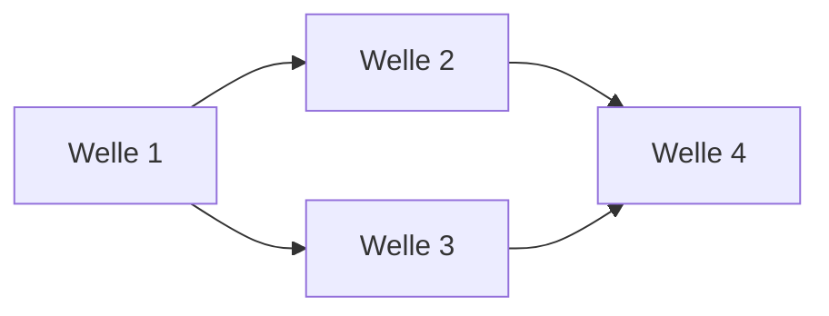

# Roadmap

**Format-Regel:** Die Roadmap ist eine Reihenfolge von **Wellen**,
keine Reihenfolge von Terminen (siehe
Baseline-Regelwerk `modul-06-roadmap.md`).
Termine werden — falls überhaupt — als Konsequenz der Wellen-Schätzung
gezeigt, nicht als Treiber.

---

## Offene Wellen

Regeln dieser Sektion: Baseline-Regelwerk `modul-06-roadmap.md`
§Roadmap-Struktur: fünf Abschnitte — *Offene Wellen* ist **derivativ**: Der
Zustand sind die flachen Welle-Dateien; woran gearbeitet wird, sagt das
`Welle:`-Feld der Slices in `in-progress/`. Ziel, Trigger und
Closure-Kriterien stehen in der Welle-Datei, nicht hier.

- [welle-qualitaet-grundlage](../welle-qualitaet-grundlage.md)
- [welle-anfrageverarbeitung](../welle-anfrageverarbeitung.md)
- [welle-betrieb-diagnose](../welle-betrieb-diagnose.md)
- [welle-referenzabgleich-release](../welle-referenzabgleich-release.md)
- [welle-produktschnitt](../welle-produktschnitt.md)
- [welle-testserver-manuell](../welle-testserver-manuell.md)

In Arbeit (Welle welle-qualitaet-grundlage):

- in `in-progress/`: keiner; zuletzt geschlossen: [slice-spec-abdeckung-liest-csharp](../done/slice-spec-abdeckung-liest-csharp.md) (Closure-Notiz in §7 des Slice; `make spec-abdeckung` liest C#-Tests, [SPEC-045](../../../../spec/spezifikation.md#spec-045--referenzabgleich-ablauf-und-ausnahmeliste-vorläufig) mit 20 Nachweisen; offen: Kopplung der `RUN`-Zeile der Stage `test`, `BEO-TDS/schwesterstage-ohne-gleichlauf-sensor`, Gradle-Teil am Layer-Cache, `BEO-TDS/abdeckungsmatrix-veraltet-ohne-sensor`), davor [slice-e2e-backend-ausserhalb-modul](../done/slice-e2e-backend-ausserhalb-modul.md) (Closure-Notiz in §7 des Slice; Stufe 8 von `make e2e` belegt [TDS-FA-08](../../../../spec/lastenheft.md#tds-fa-08--backend-anbindung) und [TDS-RB-04](../../../../spec/lastenheft.md#tds-rb-04--externes-backend); offen: Nachbesserung ohne zweiten Review, Schwellen-Vorschläge `BEO-TDS/aussage-ueber-schichtgrenze-ohne-test` und `BEO-TDS/plan-tabelle-nennt-neue-datei-nicht`), davor [slice-qa-dotnet-lieferkette-haerten](../done/slice-qa-dotnet-lieferkette-haerten.md) (Closure-Notiz in §7 des Slice; [CO-001](../../carveouts/done/CO-001-nuget-audit-aus.md) und [CO-002](../../carveouts/done/CO-002-nuget-signaturpruefung-fehlt.md) aufgelöst, [ADR-0035](../../adr/0035-dotnet-restore-signaturliste-und-audit-verzicht.md); offen: Selbsttest der Signaturliste, `BEO-TDS/signaturliste-ohne-selbsttest`, Zertifikatsrotation, `BEO-TDS/restore-haengt-am-zertifikatsstand-des-tages`), davor [slice-e2e-geruest](../done/slice-e2e-geruest.md) (Closure-Notiz in §7 des Slice; offen: Warm-/Kaltmessung der sieben Stufen, Register `BEO-TDS/e2e-nachweis-ohne-stufe-oder-messung`)

In Arbeit (Welle welle-testserver-manuell):

- in `in-progress/`: [slice-katalog-und-ddl-zustand](../in-progress/slice-katalog-und-ddl-zustand.md), [slice-handle-freigabe-und-grenze-bauen](../in-progress/slice-handle-freigabe-und-grenze-bauen.md); zuletzt geschlossen: [slice-testserver-gradle-modul](../done/slice-testserver-gradle-modul.md) ([ADR-0034](../../adr/0034-testserver-als-gradle-modul.md): Testserver als Modul `:testserver`; Abweichung von Entscheidung 8 hingenommen; Ortsangabe in [ADR-0020](../../adr/0020-logformat-und-observability-schnittstelle.md) und [ADR-0026](../../adr/0026-oeffentlichkeit-simulations-backend-und-katalog.md) als benannte Grenze, Register `BEO-TDS/angenommene-adr-fuehrt-ortsangabe-nach-umbau`), [slice-adr-testserver-bestand-und-katalog](../done/slice-adr-testserver-bestand-und-katalog.md) ([ADR-0033](../../adr/0033-callback-loesung-fuer-schreiben-struktur-und-massenladen.md) `Accepted`; offene Nutzerpunkte: Nachzug an einer angenommenen ADR, Re-Review der Fix-Stellen, Standardpfad für INT-Spalten in [TDS-FA-12](../../../../spec/lastenheft.md#tds-fa-12--testserver-mit-veränderlichem-arbeitsspeicher-bestand-und-prüfclient-d-migrate)), [slice-tls-d-migrate](../done/slice-tls-d-migrate.md) ([ADR-0032](../../adr/0032-tls-obergrenze-je-pfad-und-ticket-flag.md): der TDS-7.4-Pfad bietet höchstens TLS 1.2 an, das JVM-Flag entfällt; inkompatible Änderung der Fläche: `StartRefusal.JVM_FLAG_MISSING` entfernt; offener Nutzerpunkt: Wächter gegen ein weiter gesetztes Flag), [slice-d-migrate-verbindung-und-export](../done/slice-d-migrate-verbindung-und-export.md), [slice-prelogin-serverversion](../done/slice-prelogin-serverversion.md), [slice-testserver-manuell-doku](../done/slice-testserver-manuell-doku.md), [slice-testserver-up-down](../done/slice-testserver-up-down.md). Welle neu geschnitten (Ziel: d-migrate als Prüfclient läuft gegen den Testserver, [TDS-FA-12](../../../../spec/lastenheft.md#tds-fa-12--testserver-mit-veränderlichem-arbeitsspeicher-bestand-und-prüfclient-d-migrate) vom Nutzer freigegeben). Als Nächstes in der vom Nutzer am 2026-11-06 entschiedenen Reihenfolge: [slice-oeffentliche-flaeche-verkleinern-und-belegen](../done/slice-oeffentliche-flaeche-verkleinern-und-belegen.md), [slice-katalog-und-ddl-zustand](../in-progress/slice-katalog-und-ddl-zustand.md), danach [slice-schreibpfad-bulk-load](../open/slice-schreibpfad-bulk-load.md) und [slice-schreibpfad-merge-output](../open/slice-schreibpfad-merge-output.md) (vor diesem [slice-adr-handle-grenze-ersatz](../done/slice-adr-handle-grenze-ersatz.md)), zuletzt [slice-abnahme-d-migrate](../open/slice-abnahme-d-migrate.md) Davor geschlossen: [slice-adr-handle-grenze-ersatz](../done/slice-adr-handle-grenze-ersatz.md) ([ADR-0036](../../adr/0036-handle-freigabe-und-grenze-je-sitzung.md) `Accepted`; der Bau steht in [slice-handle-freigabe-und-grenze-bauen](../in-progress/slice-handle-freigabe-und-grenze-bauen.md)), [slice-adr-testserver-bestand-und-katalog](../done/slice-adr-testserver-bestand-und-katalog.md) ([ADR-0033](../../adr/0033-callback-loesung-fuer-schreiben-struktur-und-massenladen.md) `Accepted`; offene Nutzerpunkte: Nachzug an einer angenommenen ADR, Re-Review der Fix-Stellen, Standardpfad für INT-Spalten in [TDS-FA-12](../../../../spec/lastenheft.md#tds-fa-12--testserver-mit-veränderlichem-arbeitsspeicher-bestand-und-prüfclient-d-migrate)), [slice-tls-d-migrate](../done/slice-tls-d-migrate.md) ([ADR-0032](../../adr/0032-tls-obergrenze-je-pfad-und-ticket-flag.md): der TDS-7.4-Pfad bietet höchstens TLS 1.2 an, das JVM-Flag entfällt; inkompatible Änderung der Fläche: `StartRefusal.JVM_FLAG_MISSING` entfernt; offener Nutzerpunkt: Wächter gegen ein weiter gesetztes Flag), [slice-d-migrate-verbindung-und-export](../done/slice-d-migrate-verbindung-und-export.md), [slice-prelogin-serverversion](../done/slice-prelogin-serverversion.md), [slice-testserver-manuell-doku](../done/slice-testserver-manuell-doku.md), [slice-testserver-up-down](../done/slice-testserver-up-down.md). Welle neu geschnitten (Ziel: d-migrate als Prüfclient läuft gegen den Testserver, [TDS-FA-12](../../../../spec/lastenheft.md#tds-fa-12--testserver-mit-veränderlichem-arbeitsspeicher-bestand-und-prüfclient-d-migrate) vom Nutzer freigegeben). Als Nächstes in der vom Nutzer am 2026-11-06 entschiedenen Reihenfolge: [slice-testserver-gradle-modul](../done/slice-testserver-gradle-modul.md), [slice-oeffentliche-flaeche-verkleinern-und-belegen](../done/slice-oeffentliche-flaeche-verkleinern-und-belegen.md), [slice-katalog-und-ddl-zustand](../in-progress/slice-katalog-und-ddl-zustand.md), danach [slice-schreibpfad-bulk-load](../open/slice-schreibpfad-bulk-load.md) und [slice-schreibpfad-merge-output](../open/slice-schreibpfad-merge-output.md) (vor diesem [slice-handle-freigabe-und-grenze-bauen](../in-progress/slice-handle-freigabe-und-grenze-bauen.md), nach Modul-Umbau und Schnitt der Fläche), zuletzt [slice-abnahme-d-migrate](../open/slice-abnahme-d-migrate.md)

In Arbeit (Welle welle-anfrageverarbeitung):

- keiner; zuletzt geschlossen: [slice-anfragefolge-gesamttest](../done/slice-anfragefolge-gesamttest.md) (Closure-Notiz in §7 des Slice; offener Nutzerpunkt: Lesart „Nachrichten, nicht Transport“ des Wellen-Wortlauts „Rohbytes-Lauf“, die Welle schließt nicht ohne diesen Zusatz)

In Arbeit (Welle welle-betrieb-diagnose):

- keiner in `in-progress/`; zuletzt geschlossen: [slice-oeffentliche-flaeche-verkleinern-und-belegen](../done/slice-oeffentliche-flaeche-verkleinern-und-belegen.md) (Closure-Notiz in §7 des Slice; `make flaeche` hält die 61 Typnamen von `SPEC-059`; `BEO-TDS/oeffentliche-flaeche-der-telemetrie-ohne-entscheidung` gestrichen; offene Nutzerpunkte: `SECURITY_WEAKENED` mit `reason`, Namen `EventKind`/`issueKind`, Felder je Art nur durch Test gehalten; Folge: [slice-betrieb-log-adapter-testserver](../open/slice-betrieb-log-adapter-testserver.md), [slice-betrieb-telemetrie-verdrahtung-belegen](../open/slice-betrieb-telemetrie-verdrahtung-belegen.md)), davor [slice-betrieb-log-schnittstelle](../done/slice-betrieb-log-schnittstelle.md) (Closure-Notiz in §7 des Slice)

In Arbeit (ohne Welle):

- keiner; zuletzt geschlossen: [slice-stempel-migration](../done/slice-stempel-migration.md) (Closure-Notiz in §7 des Slice; offene Nutzerpunkte: Pflichtmenge der Klasse `immer` ([ADR-0031](../../adr/0031-gates-ohne-stempel-klasse-immer.md) Frage (b)), Grenze `assume-unchanged`, Host-Gates ohne Stage-Paar, CI-Seite)

In Arbeit (Welle welle-produktschnitt):

- keiner; zuletzt geschlossen: [slice-jar-ohne-main-und-image](../done/slice-jar-ohne-main-und-image.md) (Closure-Notiz in §7 des Slice; offene Nutzerpunkte: Zelle `make e2e` in `harness/README.md`, Name `make laufzeittest`; Folge: [slice-betrieb-log-adapter-testserver](../open/slice-betrieb-log-adapter-testserver.md), [slice-release-doku-prozess](../done/slice-release-doku-prozess.md))

In Arbeit (Welle welle-referenzabgleich-release):

- keiner; zuletzt geschlossen: [slice-qa-vergleichslauf-d-messungen](../in-progress/slice-qa-vergleichslauf-d-messungen.md) (Welle welle-qualitaet-grundlage; Closure-Notiz in §7 des Slice; offene Nutzerpunkte: [ADR-0038](../../adr/0038-abschluss-einer-rpc-antwort-im-fehlerfall-folgt-dem-echten-server.md) (`Proposed`), SESSIONSTATE senden, Ursache des Instanzunterschieds nach dem Abbruch, Re-Review der Nachbesserung, `BEO-TDS/haken-vor-verifikation-gesetzt` mit 3 Belegen; Folge: [slice-antwort-tokens-an-messung-angleichen](../open/slice-antwort-tokens-an-messung-angleichen.md) mit Nr 5 bis 8, Start-Trigger für Nr 6 und 7: [ADR-0038](../../adr/0038-abschluss-einer-rpc-antwort-im-fehlerfall-folgt-dem-echten-server.md) `Accepted`), davor [slice-referenzabgleich-mitschnitt](../done/slice-referenzabgleich-mitschnitt.md) (Closure-Notiz in §7 des Slice; Methode am 2026-11-06 bestätigt), davor [slice-referenzabgleich-live](../done/slice-referenzabgleich-live.md) (Closure-Notiz in §7 des Slice; offene Nutzerpunkte: Träger-Vorschläge im Register für sechs Lücken der Ausnahmeliste, Nachzug von `SPEC-045` und `SPEC-050`) und [slice-release-doku-prozess](../done/slice-release-doku-prozess.md) (Closure-Notiz in §7 des Slice; offene Nutzerpunkte: Entscheidungen zu Version, Tag, Registry, Signierung, Stückliste und Wächter-Form, Sensor Schlüsseltabelle gegen `ServerConfig`; Folge: [slice-release-entscheidungen](../open/slice-release-entscheidungen.md))

## Nächste Wellen

Regeln dieser Sektion: Baseline-Regelwerk `modul-06-roadmap.md`
§Roadmap-Struktur: fünf Abschnitte, Bullet *Nächste Wellen* — die geordnete
Vorschau: je Zeile Welle, Trigger als beobachtbare Bedingung, wichtigste Slices
und geschätzter Aufwand (S/M/L, kein Termin).

| Welle | Trigger | Wichtigste Slices | Geschätzter Aufwand |
|---|---|---|---|
| <welle-id-a> | <Vorgänger-Welle> done | <…> | S/M/L |
| <welle-id-b> | <welle-id-a> done + ADR-<NNNN> accepted | <…> | S/M/L |

## Meilensteine

Regeln dieser Sektion: Baseline-Regelwerk `modul-06-roadmap.md`
§Welle ≠ Meilenstein ≠ Release.

| Meilenstein | Welle(n) | Trigger | Status |
|---|---|---|---|
| M1 | <welle-id> | <…> | erreicht / offen |

## Abhängigkeitsgraph

Regeln dieser Sektion: Baseline-Regelwerk `modul-06-roadmap.md`
§Roadmap-Struktur: fünf Abschnitte, Bullet *Nächste Wellen* — die Abhängigkeit
steht als beobachtbare Bedingung in der `Trigger`-Spalte **und** als gerichtete
Kante hier; eine Welle, die ohne fertige Vorgängerin nicht starten kann, ist
eine Phantom-Welle.

## Abgeschlossene Wellen

Regeln dieser Sektion: Baseline-Regelwerk `modul-06-roadmap.md`
§Roadmap-Struktur: fünf Abschnitte.

| Welle | Abschluss | Closure-Notiz |
|---|---|---|
| welle-protokollcodec | 2026-10-30 | [welle-protokollcodec-results](../done/welle-protokollcodec-results.md) |
| welle-entscheidungen-grundlage | 2026-10-30 | [welle-entscheidungen-grundlage-results](../done/welle-entscheidungen-grundlage-results.md) |
| welle-transport-tls | 2026-10-31 | [welle-transport-tls-results](../done/welle-transport-tls-results.md) |
| welle-handshake-login | 2026-10-31 | [welle-handshake-login-results](../done/welle-handshake-login-results.md) |
| welle-backend-streaming | 2026-10-31 | [welle-backend-streaming-results](../done/welle-backend-streaming-results.md) |
| welle-simulations-backend | 2026-10-31 | [welle-simulations-backend-results](../done/welle-simulations-backend-results.md) |
| welle-fehler-abbruch | 2026-11-06 | [welle-fehler-abbruch-results](../done/welle-fehler-abbruch-results.md) |

## Historische Trigger-Verschiebungen

Regeln dieser Sektion: Baseline-Regelwerk `modul-06-roadmap.md`
§Roadmap-Struktur: fünf Abschnitte, Bullet *Historische Trigger-Verschiebungen*
— das Drift-Log: jede Umplanung mit Datum, Änderung, Grund. Leer heißt starre
Roadmap, jede Zeile voll heißt treibende.

| Datum | Was wurde geändert? | Warum? |
|---|---|---|
| 2026-10-30 | Start-Trigger von slice-adr-simulation-formen: statt „Start-Trigger der Welle welle-simulations-backend eingetreten“ gilt „slice-backend-port-vertrag in done/ und Start der Welle vom Nutzer verlangt“; Wellen-Trigger für die Code-Slices unverändert | Der Entscheidungs-Slice braucht keinen Code aus welle-backend-streaming (nur den Port); der Nutzer hat den Start verlangt |
| 2026-10-31 | slice-codec-datentypen-erweiterung (`open/`) von „ohne Welle“ in welle-anfrageverarbeitung aufgenommen | Entscheidung des Nutzers; Start-Trigger des Slice unverändert (Beleg, dass der Referenzclient die Formen sendet) |
| 2026-11-01 | slice-attention-cancel-timeout (welle-fehler-abbruch) zerlegt: Der Abbruchpfad mit Fristen bleibt unter diesem Namen, das Cancel-Szenario von SPEC-040 und der Cancel-Teil von [TDS-QA-07](../../../../spec/lastenheft.md#tds-qa-07--protokoll-synchronität) am Referenzclient gehen in slice-cancel-referenzclient-szenario; neu in derselben Welle: slice-resetconnection-zuruecksetzen. Start-Trigger statt der drei Nutzerentscheidungen: [ADR-0027](../../adr/0027-abbruch-und-zuruecksetzen.md) Accepted | Fünf Liefer-Punkte lagen über der Grenze von drei; die Nutzerentscheidungen liegen mit [ADR-0027](../../adr/0027-abbruch-und-zuruecksetzen.md) vor |
| 2026-11-01 | Start-Trigger von [welle-produktschnitt](../welle-produktschnitt.md) gelockert: statt „[ADR-0025](../../adr/0025-produktschnitt-bibliothek-und-testserver.md) `Accepted` und [welle-anfrageverarbeitung](../welle-anfrageverarbeitung.md), [welle-fehler-abbruch](../done/welle-fehler-abbruch.md), [welle-betrieb-diagnose](../welle-betrieb-diagnose.md) in `done/`“ gilt „[ADR-0025](../../adr/0025-produktschnitt-bibliothek-und-testserver.md) `Accepted` und der Nutzer verlangt den Start“; der Slice [slice-explicit-api-umbau](../done/slice-explicit-api-umbau.md) (`open/`) von „ohne Welle“ in diese Welle aufgenommen, Start-Trigger des Slice: `slice-testserver-herausloesen` in `done/` | Nutzerentscheidung 2026-11-01: Die Auswahl der drei Wellen war eine Lesart des Planners und ist hinfällig; der Umbau soll nicht auf Betrieb und Abbruch warten, und `explicitApi` soll erst nach dem Testserver-Umbau schließen, damit nicht zweimal umgebaut wird |
| 2026-11-01 | [welle-betrieb-diagnose](../welle-betrieb-diagnose.md) nach Annahme von [ADR-0020](../../adr/0020-logformat-und-observability-schnittstelle.md) neu zugeschnitten: Slices [slice-spec-nachzug-telemetrie](../done/slice-spec-nachzug-telemetrie.md) und [slice-betrieb-log-adapter-testserver](../open/slice-betrieb-log-adapter-testserver.md) neu; Start-Trigger von `slice-betrieb-log-schnittstelle` und des Adapter-Slice an `slice-testserver-herausloesen` aus [welle-produktschnitt](../welle-produktschnitt.md) gebunden, die der Zustands- und Metriken-Slice an den Adapter-Slice | [ADR-0020](../../adr/0020-logformat-und-observability-schnittstelle.md) legt Modell und Senke in die Bibliothek und das Format als Adapter in den Testserver; der frühere Punkt „Adapter und Konfiguration“ hätte den Slice auf sechs Liefer-Punkte gebracht |
| 2026-11-01 | [welle-referenzabgleich-release](../welle-referenzabgleich-release.md): Vermerk „berührt durch [ADR-0025](../../adr/0025-produktschnitt-bibliothek-und-testserver.md)“ am Closure-Kriterium „Läufe gegen das Laufzeit-Image“ und an der Nutzer-Doku zum Start im Container; Wortlaut nicht umgeschrieben, das Umschreiben ist Teil von `slice-jar-ohne-main-und-image` | Nutzerentscheidung 2026-11-01: [ADR-0025](../../adr/0025-produktschnitt-bibliothek-und-testserver.md) entfernt das Produkt-Image, umgeschrieben wird erst im Zug des Bau-Slice |
| 2026-11-01 | Spec-Nachzug zu Abschnitt 4 und 5 aus dem Liefer-Punkt 3 von slice-adr-observability gelöst und bei [slice-spec-nachzug-telemetrie](../done/slice-spec-nachzug-telemetrie.md) geführt; [welle-betrieb-diagnose](../welle-betrieb-diagnose.md) §4 nennt den Slice ohne Spec-Arbeit | Review M-4 von slice-adr-observability: zwei Träger für dieselbe Spec-Arbeit; Bestätigung durch den Nutzer steht aus |
| 2026-11-01 | [slice-betrieb-telemetrie-verdrahtung-belegen](../open/slice-betrieb-telemetrie-verdrahtung-belegen.md) in [welle-betrieb-diagnose](../welle-betrieb-diagnose.md) aufgenommen | Verifikation von [slice-betrieb-log-schnittstelle](../done/slice-betrieb-log-schnittstelle.md): `AcceptFailed` und `ConnectionFailed` ohne Test über den Server, Ausgabe-Sperre ohne Rot-Fall je Package |
| 2026-11-06 | Start-Trigger von [slice-katalog-und-ddl-zustand](../in-progress/slice-katalog-und-ddl-zustand.md), [slice-schreibpfad-bulk-load](../open/slice-schreibpfad-bulk-load.md), [slice-schreibpfad-merge-output](../open/slice-schreibpfad-merge-output.md) und [slice-oeffentliche-flaeche-verkleinern-und-belegen](../done/slice-oeffentliche-flaeche-verkleinern-und-belegen.md) um die Kette Modul-Umbau, Schnitt der Fläche, Katalog ergänzt; [slice-adr-handle-grenze-ersatz](../done/slice-adr-handle-grenze-ersatz.md) neu in [welle-testserver-manuell](../welle-testserver-manuell.md), vor dem MERGE-Slice | Nutzerentscheidung 2026-11-06 ([ADR-0033](../../adr/0033-callback-loesung-fuer-schreiben-struktur-und-massenladen.md), [ADR-0034](../../adr/0034-testserver-als-gradle-modul.md)): Reihenfolge der Folge-Slices abweichend vom Entwurf; die Handle-Grenze von [ADR-0017](../../adr/0017-prepared-handles-grenzwert.md) bricht den MERGE-Import |
| 2026-11-06 | [slice-handle-freigabe-und-grenze-bauen](../in-progress/slice-handle-freigabe-und-grenze-bauen.md) neu in [welle-testserver-manuell](../welle-testserver-manuell.md), nach Modul-Umbau und Schnitt der Fläche, vor [slice-schreibpfad-merge-output](../open/slice-schreibpfad-merge-output.md) (dessen Start-Trigger um ihn ergänzt) | Folgepflicht 2 von [ADR-0036](../../adr/0036-handle-freigabe-und-grenze-je-sitzung.md) (`Accepted`, Option D mit B): Bau getrennt von der Entscheidung |
| 2026-11-06 | [slice-qa-passwortvergleich-gemischte-liste](../open/slice-qa-passwortvergleich-gemischte-liste.md) neu in [welle-qualitaet-grundlage](../welle-qualitaet-grundlage.md) | Nutzerentscheid 2026-11-06: Träger der Beobachtung `BEO-TDS/passwortvergleich-gemischte-liste-ohne-traeger` (Review F-4); Passung: Bezug [TDS-QA-03](../../../../spec/lastenheft.md#tds-qa-03--sicherheit), die Welle belegt die Qualitätsseite |
| YYYY-MM-DD | <…> | <…> |
