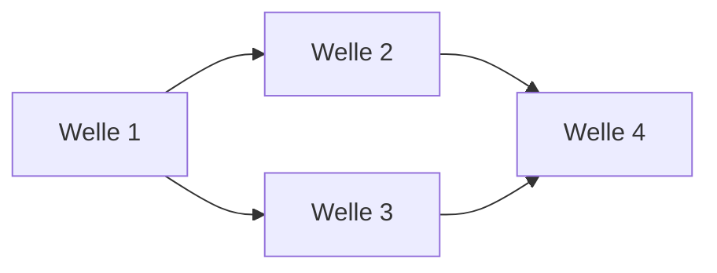

# Roadmap

**Format-Regel:** Die Roadmap ist eine Reihenfolge von **Wellen**,
keine Reihenfolge von Terminen (siehe
Baseline-Regelwerk `modul-06-roadmap.md`).
Termine werden — falls überhaupt — als Konsequenz der Wellen-Schätzung
gezeigt, nicht als Treiber.

---

## Offene Wellen

Regeln dieser Sektion: Baseline-Regelwerk `modul-06-roadmap.md`
§Roadmap-Struktur: fünf Abschnitte — *Offene Wellen* ist **derivativ**: Der
Zustand sind die flachen Welle-Dateien; woran gearbeitet wird, sagt das
`Welle:`-Feld der Slices in `in-progress/`. Ziel, Trigger und
Closure-Kriterien stehen in der Welle-Datei, nicht hier.

- [welle-qualitaet-grundlage](../welle-qualitaet-grundlage.md)
- [welle-anfrageverarbeitung](../welle-anfrageverarbeitung.md)
- [welle-fehler-abbruch](../welle-fehler-abbruch.md)
- [welle-betrieb-diagnose](../welle-betrieb-diagnose.md)
- [welle-referenzabgleich-release](../welle-referenzabgleich-release.md)
- [welle-produktschnitt](../welle-produktschnitt.md)

In Arbeit (Welle welle-qualitaet-grundlage):

- [slice-e2e-geruest](slice-e2e-geruest.md)

In Arbeit (Welle welle-fehler-abbruch):

- keiner; zuletzt geschlossen: [slice-resetconnection-zuruecksetzen](../done/slice-resetconnection-zuruecksetzen.md) (Closure-Notiz in §7 des Slice; offene Nutzerpunkte: Handle-Aliasing nach dem Zurücksetzen; Folge: [slice-cancel-referenzclient-szenario](../open/slice-cancel-referenzclient-szenario.md), [slice-abbruch-ressourcen-shutdown](../open/slice-abbruch-ressourcen-shutdown.md))

In Arbeit (Welle welle-betrieb-diagnose):

- keiner; zuletzt geschlossen: [slice-spec-nachzug-telemetrie](../done/slice-spec-nachzug-telemetrie.md) (Closure-Notiz in §7 des Slice; Folge: [slice-betrieb-log-schnittstelle](../in-progress/slice-betrieb-log-schnittstelle.md) mit offenen Nutzerpunkten [ADR-0029](../../adr/0029-log-parameter-am-einstieg.md) (`Proposed`) und `StartOutcome.Aborted.reason`)

In Arbeit (ohne Welle):

- keiner; zuletzt geschlossen: [slice-stempel-migration](../done/slice-stempel-migration.md) (Closure-Notiz in §7 des Slice; offene Nutzerpunkte: Pflichtmenge der Klasse `immer` ([ADR-0031](../../adr/0031-gates-ohne-stempel-klasse-immer.md) Frage (b)), Grenze `assume-unchanged`, Host-Gates ohne Stage-Paar, CI-Seite)

In Arbeit (Welle welle-produktschnitt):

- keiner; zuletzt geschlossen: [slice-jar-ohne-main-und-image](../done/slice-jar-ohne-main-und-image.md) (Closure-Notiz in §7 des Slice; offene Nutzerpunkte: Zelle `make e2e` in `harness/README.md`, Name `make laufzeittest`; Folge: [slice-betrieb-log-adapter-testserver](../open/slice-betrieb-log-adapter-testserver.md), [slice-release-doku-prozess](../open/slice-release-doku-prozess.md))

## Nächste Wellen

Regeln dieser Sektion: Baseline-Regelwerk `modul-06-roadmap.md`
§Roadmap-Struktur: fünf Abschnitte, Bullet *Nächste Wellen* — die geordnete
Vorschau: je Zeile Welle, Trigger als beobachtbare Bedingung, wichtigste Slices
und geschätzter Aufwand (S/M/L, kein Termin).

| Welle | Trigger | Wichtigste Slices | Geschätzter Aufwand |
|---|---|---|---|
| <welle-id-a> | <Vorgänger-Welle> done | <…> | S/M/L |
| <welle-id-b> | <welle-id-a> done + ADR-<NNNN> accepted | <…> | S/M/L |

## Meilensteine

Regeln dieser Sektion: Baseline-Regelwerk `modul-06-roadmap.md`
§Welle ≠ Meilenstein ≠ Release.

| Meilenstein | Welle(n) | Trigger | Status |
|---|---|---|---|
| M1 | <welle-id> | <…> | erreicht / offen |

## Abhängigkeitsgraph

Regeln dieser Sektion: Baseline-Regelwerk `modul-06-roadmap.md`
§Roadmap-Struktur: fünf Abschnitte, Bullet *Nächste Wellen* — die Abhängigkeit
steht als beobachtbare Bedingung in der `Trigger`-Spalte **und** als gerichtete
Kante hier; eine Welle, die ohne fertige Vorgängerin nicht starten kann, ist
eine Phantom-Welle.

## Abgeschlossene Wellen

Regeln dieser Sektion: Baseline-Regelwerk `modul-06-roadmap.md`
§Roadmap-Struktur: fünf Abschnitte.

| Welle | Abschluss | Closure-Notiz |
|---|---|---|
| welle-protokollcodec | 2026-10-30 | [welle-protokollcodec-results](../done/welle-protokollcodec-results.md) |
| welle-entscheidungen-grundlage | 2026-10-30 | [welle-entscheidungen-grundlage-results](../done/welle-entscheidungen-grundlage-results.md) |
| welle-transport-tls | 2026-10-31 | [welle-transport-tls-results](../done/welle-transport-tls-results.md) |
| welle-handshake-login | 2026-10-31 | [welle-handshake-login-results](../done/welle-handshake-login-results.md) |
| welle-backend-streaming | 2026-10-31 | [welle-backend-streaming-results](../done/welle-backend-streaming-results.md) |
| welle-simulations-backend | 2026-10-31 | [welle-simulations-backend-results](../done/welle-simulations-backend-results.md) |

## Historische Trigger-Verschiebungen

Regeln dieser Sektion: Baseline-Regelwerk `modul-06-roadmap.md`
§Roadmap-Struktur: fünf Abschnitte, Bullet *Historische Trigger-Verschiebungen*
— das Drift-Log: jede Umplanung mit Datum, Änderung, Grund. Leer heißt starre
Roadmap, jede Zeile voll heißt treibende.

| Datum | Was wurde geändert? | Warum? |
|---|---|---|
| 2026-10-30 | Start-Trigger von slice-adr-simulation-formen: statt „Start-Trigger der Welle welle-simulations-backend eingetreten“ gilt „slice-backend-port-vertrag in done/ und Start der Welle vom Nutzer verlangt“; Wellen-Trigger für die Code-Slices unverändert | Der Entscheidungs-Slice braucht keinen Code aus welle-backend-streaming (nur den Port); der Nutzer hat den Start verlangt |
| 2026-10-31 | slice-codec-datentypen-erweiterung (`open/`) von „ohne Welle“ in welle-anfrageverarbeitung aufgenommen | Entscheidung des Nutzers; Start-Trigger des Slice unverändert (Beleg, dass der Referenzclient die Formen sendet) |
| 2026-11-01 | slice-attention-cancel-timeout (welle-fehler-abbruch) zerlegt: Der Abbruchpfad mit Fristen bleibt unter diesem Namen, das Cancel-Szenario von SPEC-040 und der Cancel-Teil von [TDS-QA-07](../../../../spec/lastenheft.md#tds-qa-07--protokoll-synchronität) am Referenzclient gehen in slice-cancel-referenzclient-szenario; neu in derselben Welle: slice-resetconnection-zuruecksetzen. Start-Trigger statt der drei Nutzerentscheidungen: [ADR-0027](../../adr/0027-abbruch-und-zuruecksetzen.md) Accepted | Fünf Liefer-Punkte lagen über der Grenze von drei; die Nutzerentscheidungen liegen mit [ADR-0027](../../adr/0027-abbruch-und-zuruecksetzen.md) vor |
| 2026-11-01 | Start-Trigger von [welle-produktschnitt](../welle-produktschnitt.md) gelockert: statt „[ADR-0025](../../adr/0025-produktschnitt-bibliothek-und-testserver.md) `Accepted` und [welle-anfrageverarbeitung](../welle-anfrageverarbeitung.md), [welle-fehler-abbruch](../welle-fehler-abbruch.md), [welle-betrieb-diagnose](../welle-betrieb-diagnose.md) in `done/`“ gilt „[ADR-0025](../../adr/0025-produktschnitt-bibliothek-und-testserver.md) `Accepted` und der Nutzer verlangt den Start“; der Slice [slice-explicit-api-umbau](../done/slice-explicit-api-umbau.md) (`open/`) von „ohne Welle“ in diese Welle aufgenommen, Start-Trigger des Slice: `slice-testserver-herausloesen` in `done/` | Nutzerentscheidung 2026-11-01: Die Auswahl der drei Wellen war eine Lesart des Planners und ist hinfällig; der Umbau soll nicht auf Betrieb und Abbruch warten, und `explicitApi` soll erst nach dem Testserver-Umbau schließen, damit nicht zweimal umgebaut wird |
| 2026-11-01 | [welle-betrieb-diagnose](../welle-betrieb-diagnose.md) nach Annahme von [ADR-0020](../../adr/0020-logformat-und-observability-schnittstelle.md) neu zugeschnitten: Slices [slice-spec-nachzug-telemetrie](../done/slice-spec-nachzug-telemetrie.md) und [slice-betrieb-log-adapter-testserver](../open/slice-betrieb-log-adapter-testserver.md) neu; Start-Trigger von `slice-betrieb-log-schnittstelle` und des Adapter-Slice an `slice-testserver-herausloesen` aus [welle-produktschnitt](../welle-produktschnitt.md) gebunden, die der Zustands- und Metriken-Slice an den Adapter-Slice | [ADR-0020](../../adr/0020-logformat-und-observability-schnittstelle.md) legt Modell und Senke in die Bibliothek und das Format als Adapter in den Testserver; der frühere Punkt „Adapter und Konfiguration“ hätte den Slice auf sechs Liefer-Punkte gebracht |
| 2026-11-01 | [welle-referenzabgleich-release](../welle-referenzabgleich-release.md): Vermerk „berührt durch [ADR-0025](../../adr/0025-produktschnitt-bibliothek-und-testserver.md)“ am Closure-Kriterium „Läufe gegen das Laufzeit-Image“ und an der Nutzer-Doku zum Start im Container; Wortlaut nicht umgeschrieben, das Umschreiben ist Teil von `slice-jar-ohne-main-und-image` | Nutzerentscheidung 2026-11-01: [ADR-0025](../../adr/0025-produktschnitt-bibliothek-und-testserver.md) entfernt das Produkt-Image, umgeschrieben wird erst im Zug des Bau-Slice |
| 2026-11-01 | Spec-Nachzug zu Abschnitt 4 und 5 aus dem Liefer-Punkt 3 von slice-adr-observability gelöst und bei [slice-spec-nachzug-telemetrie](../done/slice-spec-nachzug-telemetrie.md) geführt; [welle-betrieb-diagnose](../welle-betrieb-diagnose.md) §4 nennt den Slice ohne Spec-Arbeit | Review M-4 von slice-adr-observability: zwei Träger für dieselbe Spec-Arbeit; Bestätigung durch den Nutzer steht aus |
| YYYY-MM-DD | <…> | <…> |
