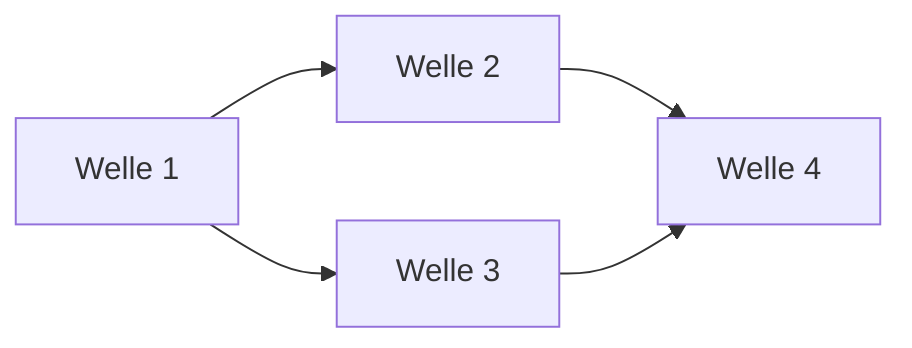

# Roadmap

**Format-Regel:** Die Roadmap ist eine Reihenfolge von **Wellen**,
keine Reihenfolge von Terminen (siehe
Baseline-Regelwerk `modul-06-roadmap.md`).
Termine werden — falls überhaupt — als Konsequenz der Wellen-Schätzung
gezeigt, nicht als Treiber.

---

## Offene Wellen

Regeln dieser Sektion: Baseline-Regelwerk `modul-06-roadmap.md`
§Roadmap-Struktur: fünf Abschnitte — *Offene Wellen* ist **derivativ**: Der
Zustand sind die flachen Welle-Dateien; woran gearbeitet wird, sagt das
`Welle:`-Feld der Slices in `in-progress/`. Ziel, Trigger und
Closure-Kriterien stehen in der Welle-Datei, nicht hier.

- [welle-qualitaet-grundlage](../welle-qualitaet-grundlage.md)
- [welle-anfrageverarbeitung](../welle-anfrageverarbeitung.md)
- [welle-backend-streaming](../welle-backend-streaming.md)
- [welle-fehler-abbruch](../welle-fehler-abbruch.md)
- [welle-simulations-backend](../welle-simulations-backend.md)
- [welle-betrieb-diagnose](../welle-betrieb-diagnose.md)
- [welle-referenzabgleich-release](../welle-referenzabgleich-release.md)

In Arbeit (Welle welle-anfrageverarbeitung):

- [slice-rpc-executesql-parameter](slice-rpc-executesql-parameter.md)

In Arbeit (Welle welle-simulations-backend):

- [slice-sim-erkennung](slice-sim-erkennung.md)

In Arbeit (Welle welle-qualitaet-grundlage):

- [slice-qa-wartbarkeit](slice-qa-wartbarkeit.md)

## Nächste Wellen

Regeln dieser Sektion: Baseline-Regelwerk `modul-06-roadmap.md`
§Roadmap-Struktur: fünf Abschnitte, Bullet *Nächste Wellen* — die geordnete
Vorschau: je Zeile Welle, Trigger als beobachtbare Bedingung, wichtigste Slices
und geschätzter Aufwand (S/M/L, kein Termin).

| Welle | Trigger | Wichtigste Slices | Geschätzter Aufwand |
|---|---|---|---|
| <welle-id-a> | <Vorgänger-Welle> done | <…> | S/M/L |
| <welle-id-b> | <welle-id-a> done + ADR-<NNNN> accepted | <…> | S/M/L |

## Meilensteine

Regeln dieser Sektion: Baseline-Regelwerk `modul-06-roadmap.md`
§Welle ≠ Meilenstein ≠ Release.

| Meilenstein | Welle(n) | Trigger | Status |
|---|---|---|---|
| M1 | <welle-id> | <…> | erreicht / offen |

## Abhängigkeitsgraph

Regeln dieser Sektion: Baseline-Regelwerk `modul-06-roadmap.md`
§Roadmap-Struktur: fünf Abschnitte, Bullet *Nächste Wellen* — die Abhängigkeit
steht als beobachtbare Bedingung in der `Trigger`-Spalte **und** als gerichtete
Kante hier; eine Welle, die ohne fertige Vorgängerin nicht starten kann, ist
eine Phantom-Welle.

## Abgeschlossene Wellen

Regeln dieser Sektion: Baseline-Regelwerk `modul-06-roadmap.md`
§Roadmap-Struktur: fünf Abschnitte.

| Welle | Abschluss | Closure-Notiz |
|---|---|---|
| welle-protokollcodec | 2026-10-30 | [welle-protokollcodec-results](../done/welle-protokollcodec-results.md) |
| welle-entscheidungen-grundlage | 2026-10-30 | [welle-entscheidungen-grundlage-results](../done/welle-entscheidungen-grundlage-results.md) |
| welle-transport-tls | 2026-10-31 | [welle-transport-tls-results](../done/welle-transport-tls-results.md) |
| welle-handshake-login | 2026-10-31 | [welle-handshake-login-results](../done/welle-handshake-login-results.md) |

## Historische Trigger-Verschiebungen

Regeln dieser Sektion: Baseline-Regelwerk `modul-06-roadmap.md`
§Roadmap-Struktur: fünf Abschnitte, Bullet *Historische Trigger-Verschiebungen*
— das Drift-Log: jede Umplanung mit Datum, Änderung, Grund. Leer heißt starre
Roadmap, jede Zeile voll heißt treibende.

| Datum | Was wurde geändert? | Warum? |
|---|---|---|
| 2026-10-30 | Start-Trigger von slice-adr-simulation-formen: statt „Start-Trigger der Welle welle-simulations-backend eingetreten“ gilt „slice-backend-port-vertrag in done/ und Start der Welle vom Nutzer verlangt“; Wellen-Trigger für die Code-Slices unverändert | Der Entscheidungs-Slice braucht keinen Code aus welle-backend-streaming (nur den Port); der Nutzer hat den Start verlangt |
| 2026-10-31 | slice-codec-datentypen-erweiterung (`open/`) von „ohne Welle“ in welle-anfrageverarbeitung aufgenommen | Entscheidung des Nutzers; Start-Trigger des Slice unverändert (Beleg, dass der Referenzclient die Formen sendet) |
| YYYY-MM-DD | <…> | <…> |
