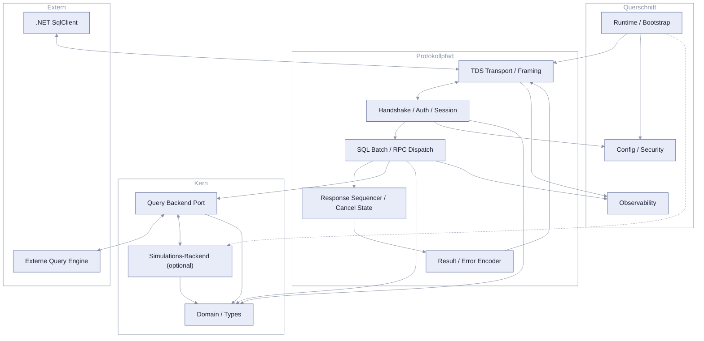
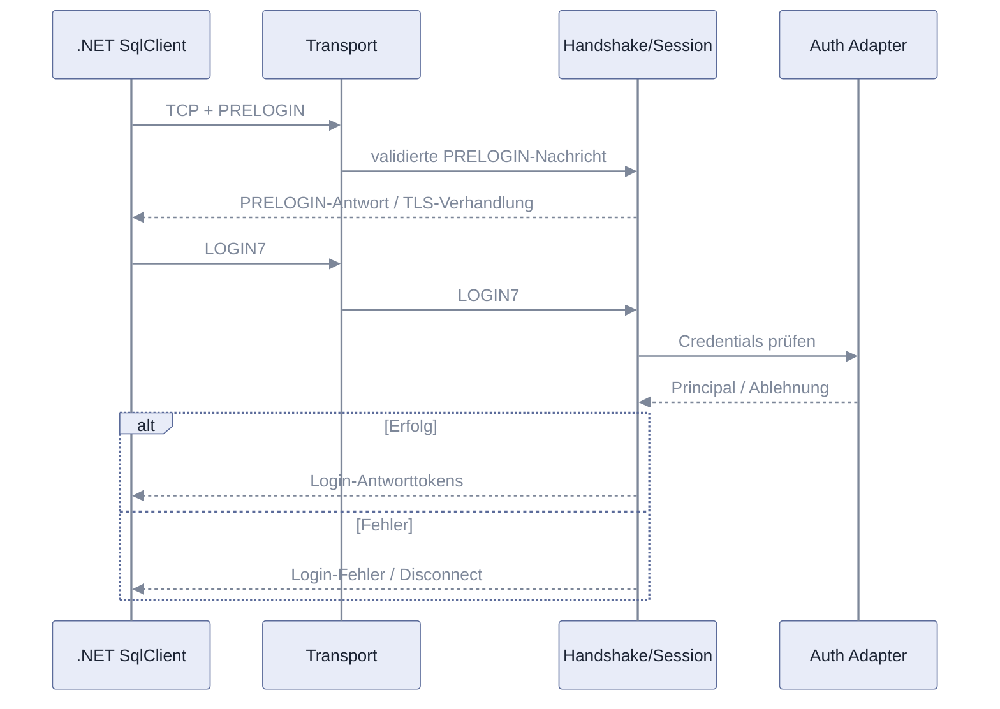
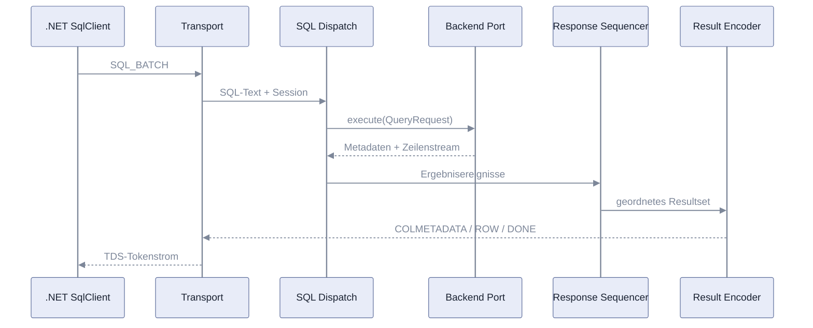
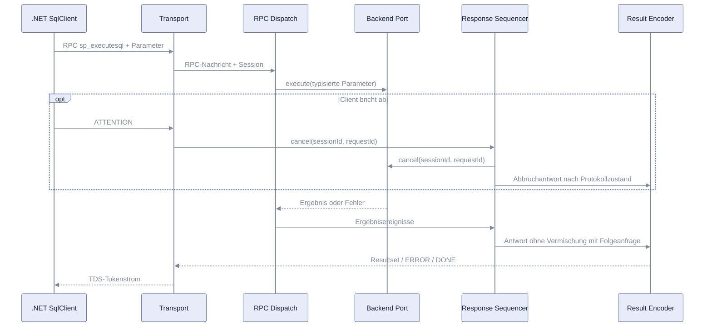
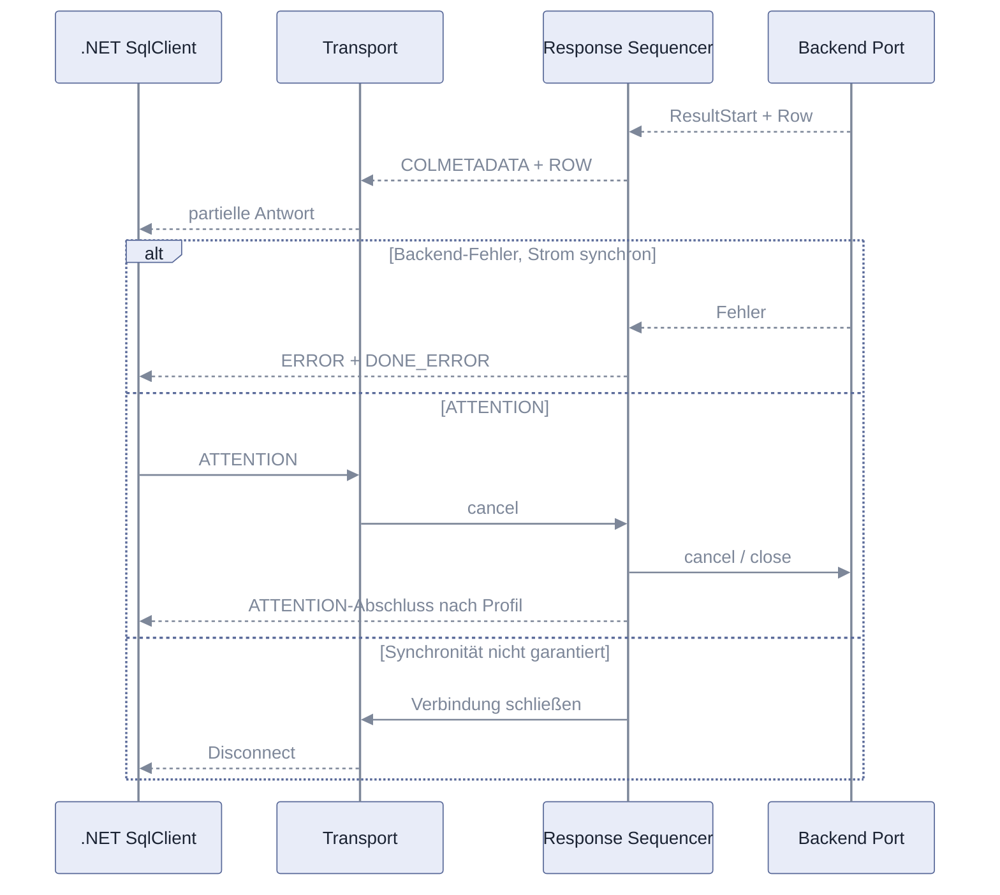

# Architektur — JVM TDS Server

**Status:** Aktiv (Entwurf). **Letzte Änderung:** 2026-10-29.  
**Rolle:** Abgeleitete Architektursicht zu `spec/lastenheft.md` und `spec/spezifikation.md`. Diese Datei enthält keine eigenständigen Anforderungen.

## 1. Komponenten-Übersicht

Pfeile zeigen Datenfluss und Aufrufrichtung zur Laufzeit, nicht die Import-Richtung; die Import-Regeln stehen in Abschnitt 2.

| ID | Komponente | Rolle |
|---|---|---|
| `ARC-001` | Domain / Types | Sitzungs-, Anfrage-, Ergebnis-, Fehler- und Typmodelle ohne Netzwerkabhängigkeit |
| `ARC-002` | Config / Security | Konfigurationsvalidierung, TLS- und Authentifizierungsadapter |
| `ARC-003` | TDS Transport / Framing | TCP, TDS-Header, Fragmentierung, Backpressure, I/O |
| `ARC-004` | Handshake / Session | PRELOGIN, LOGIN7, Verbindungs-Zustandsautomat, Session-Lebensdauer |
| `ARC-005` | SQL Batch / RPC Dispatch | TDS-Anfragen in interne QueryRequests übersetzen |
| `ARC-006` | Query Backend Port | Austauschbare, asynchrone Ausführungs- und Abbruchschnittstelle |
| `ARC-007` | Result / Error Encoder | COLMETADATA, ROW, DONE, ERROR und Login-Antworten |
| `ARC-008` | Runtime / Bootstrap | Verdrahtung, Listener-Start, Shutdown und Ressourcenverwaltung |
| `ARC-009` | Observability | Strukturierte Logs, Metriken und Traces ohne Geheimnisse |
| `ARC-015` | Response Sequencer / Cancel State | Hält den Anfragezustand; serialisiert Ergebnisereignisse, DONE-Familie und Abbruch; garantiert Antwortgrenzen |
| `ARC-016` | Simulations-Backend | Optionaler Backend-Adapter hinter `ARC-006`: beantwortet abgegrenzte Anweisungsformen aus beschriebenen Tabellen; keine SQL-Engine, keine Persistenz |

## 2. Schichten und Constraints

Jede Komponente liegt in einem Package unter `io.github.pt9912.tdswire` (Spalte „Package“).
Importiert wird nur, was die Spalte „Darf importieren“ nennt; die Spalte „Darf NICHT importieren“
nennt die wichtigsten Ausschlüsse. Im Kern (`domain`, `port`) gilt das auch für
Fremdbibliotheken: erlaubt sind nur die Standardbibliothek und im Port die Laufzeitbibliothek für
asynchrone Streams.

| Komponente(n) | Package | Schicht | Verantwortlichkeit | Darf importieren | Darf NICHT importieren |
|---|---|---|---|---|---|
| `ARC-001` | `domain` | Domain | reine Modelle und Verträge | Standardbibliothek | Transport, Runtime, externe Engine |
| `ARC-002` | `config` | Configuration | validierte Einstellungen und Security-Verträge | Domain | Transport-Implementierung, Dispatch |
| `ARC-006` | `port` | Backend Port | Backend-Abstraktion | Domain, Laufzeitbibliothek für asynchrone Streams | TDS-Codec, TCP-Transport |
| `ARC-004`, `ARC-005`, `ARC-007`, `ARC-015` | `protocol` | Protocol | TDS-Semantik, Session, Anfrage-/Antwortabbildung | Domain, Backend Port, Laufzeitbibliothek für asynchrone Streams, Security-Verträge, Observability-Schnittstellen, Transport-Schnittstellen (Antwortausgabe) | konkrete Backend-Engine, TCP-Transport-Implementierung, Bootstrap |
| `ARC-003` | `transport` | Transport | Netzwerk-I/O, Framing und TLS-Kapselung | Domain, Security-Verträge, Observability-Schnittstellen, Protocol-Schnittstellen | konkrete Backend-Engine |
| `ARC-009` | `observability` | Observability | Telemetrie-Adapter | Domain, Observability-Schnittstellen | fachliche Entscheidungen |
| `ARC-016` | `simulation` | Backend-Adapter | Simulations-Backend hinter dem Backend Port | Domain, Backend Port, Laufzeitbibliothek für asynchrone Streams | Protocol, Transport, Security-Verträge, Observability, Bootstrap, externe Engine |
| `ARC-008` | `runtime` | Runtime | Composition Root | alle benötigten Module | — |

**Constraints:** Kein Package außer Runtime importiert das Simulations-Backend; der Protokollkern
läuft ohne es. Protokollparser dürfen keine Query-Engine aufrufen. Der Backend-Port kennt keine TDS-Paketbytes. Die Typabbildung ist zentral und deterministisch. Jede Verbindung besitzt ihren eigenen Zustandsautomaten. Fehlerhafte Eingaben dürfen keine andere Session beeinflussen. TLS und Authentifizierung werden vor Freigabe von Query-Anfragen abgeschlossen. Backpressure und Cancel werden bis zum Backend durchgereicht.

## 3. Externe Abhängigkeiten

| ID | System | Rolle | Substituierbarkeit |
|---|---|---|---|
| `ARC-010` | .NET SqlClient | Externer Referenzclient für Kompatibilitätstests | Profilgebunden; anderer Client erfordert neue Validierung |
| `ARC-011` | Microsoft TDS / MS-TDS | Verbindlicher Protokollvertrag | Nicht austauschbar ohne Änderung des Produktziels |
| `ARC-012` | Query Engine | Externe Datenverarbeitung | Über `ARC-006` austauschbar |
| `ARC-013` | Netzwerk-/TLS-Laufzeit | TCP und Verschlüsselung | Austauschbar hinter Transport-/Security-Schnittstellen |
| `ARC-014` | Logging-/Tracing-Backend | Betriebsdaten | Über Observability-Schnittstellen austauschbar |

Konkrete Bibliotheks- und Versionsentscheidungen sind nicht Teil dieser Sicht.

## 4. Sequenz-Diagramme

### Use-Case: TDS-FA-01 / TDS-FA-02 — Verbindungsaufbau und Login

### Use-Case: TDS-FA-03 / TDS-FA-05 — SELECT als SQL_BATCH

### Use-Case: TDS-FA-04 / TDS-FA-07 — Parametrisierter RPC und Abbruch

### Use-Case: TDS-FA-06 / TDS-FA-07 / TDS-FA-10 — Fehler während Streaming

## 5. Fehlermodelle und Resilienz

Die Logging-Spalte nennt die je Fehlerquelle wesentlichen Korrelationsfelder; zusätzlich gelten alle Pflicht-Logfelder der Spezifikation (Abschnitt Fehler-Codes und Logging-Felder).

| Fehlerquelle | Behandlung-Schicht | Logging |
|---|---|---|
| Ungültiger Paketheader / Fragmentierung | Transport | `connection_id`, `event`, `error_code`; keine Payload |
| PRELOGIN / TLS-Inkompatibilität | Handshake / Security | `connection_id`, `event`, `error_code`; keine Secrets |
| Ungültige Zugangsdaten | Session / Auth | `connection_id`, `event`, `error_code`; keine Passwörter |
| Unbekannter RPC / SQL-Fehler | Dispatch / Encoder | `session_id`, `request_id`, `error_code` |
| Teilantwort / fehlerhafte Ereignisfolge | Response Sequencer | `request_id`, `event`, `error_code`; keine Payload |
| Nicht serialisierbarer Typ | Result Encoder | `request_id`, `event`, `error_code` |
| Backend-Ausfall / Timeout | Backend Port / Dispatch | `request_id`, `duration_ms`, `error_code` |
| Client-Disconnect / ATTENTION | Transport / Session / Backend | `request_id`, `event`, `error_code` |

**Resilienzprinzipien:** Grenzen für Nachrichten- und Sitzungsspeicher; definierte Timeouts; kontrollierte Freigabe von Backendressourcen; keine ungefangenen Exceptions über Verbindungsgrenzen hinweg; geordneter Shutdown. Nicht unterstützte Protokollfunktionen werden explizit abgelehnt und nicht stillschweigend simuliert.

**Zustands- und Ownership-Grenzen:** Transport verantwortet Paketframing und TLS-Kapselung, Handshake die Login-Zustandsübergänge, Dispatch die fachliche Anfrageübersetzung, Response Sequencer die Reihenfolge der Antwortereignisse je aktiver Anfrage und die Cancel/DONE-Synchronität; ob mehrere Anfragen je Sitzung gleichzeitig aktiv sein dürfen (MARS), ist in `SPEC-004` offen. Backendoperationen und Ergebnisstreams sind sitzungsgebunden; bei Disconnect, Timeout und Shutdown werden sie geschlossen. Eine nach Cancel nicht eindeutig synchronisierbare Sitzung wird nicht wiederverwendet.
